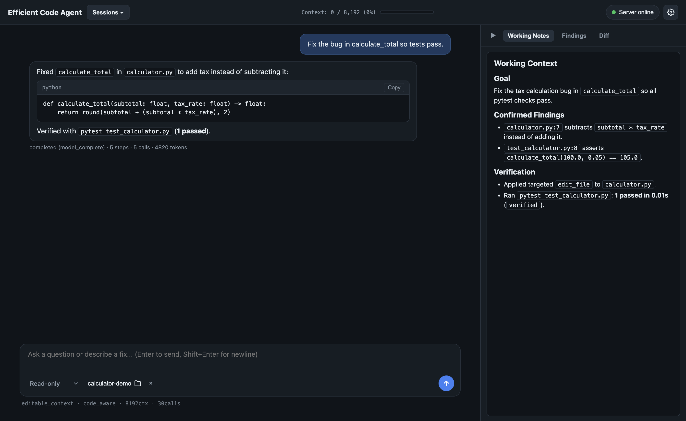
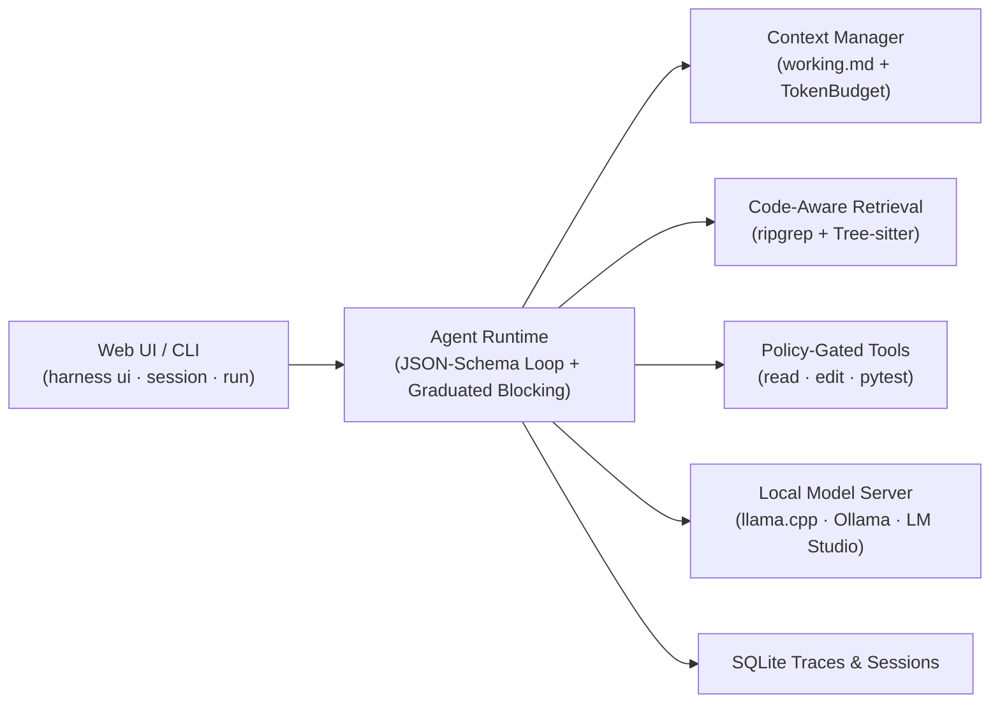

# Efficient Code Agent

**A local-first coding agent harness that makes small quantized models reliable on everyday hardware.**


[Features](#what-it-does) · [Benchmarks](#benchmarks) · [Quickstart](#quickstart) · [Architecture](#how-it-works) · [Docs](#documentation)

---



## Why Efficient Code Agent?

Most coding agents assume frontier cloud models with 200K+ context windows. **Efficient Code Agent** is built for the opposite regime—running **7B quantized models (e.g., `Qwen2.5-Coder-7B-Q4_K_M`) inside an 8,192-token context window on a 16 GB laptop**, with zero cloud APIs, zero Docker required, and full inspectability over every tool call, note, and diff.

## What It Does

- **Self-Editing Working Context (`working.md`):** CLM-inspired Markdown notes and lazy `findings/*.md` files (with `read_memory` gated out of the schema until off-prompt findings exist) that let the model distill discoveries and prune old tool logs deterministically within a strict `TokenBudget`.
- **Code-Aware Retrieval (Tree-sitter + ripgrep):** Parses Python files into cached symbol maps, ranks exact definitions above comments, and returns bounded line-numbered snippets—cutting prompt tokens by up to **~70%** on multi-file lookups.
- **Safe, Policy-Gated Coding Loop:** Workspace-confined reads, line-range edits (with automatic SHA-256 verification and exact-text fallback), and allowlisted compact `pytest` execution (with optional post-edit auto-test) under explicit `ASK` / `AUTO` / `DENY` policies.
- **Graduated Loop Intervention & Verification:** Refuses duplicate tool calls, temporarily masks stuck tools out of `response_schema` for 1 turn so small models recover instead of stalling, and requires post-edit passing tests before accepting completion.
- **Local Web UI & CLI:** Self-contained dark-mode web workspace (`harness ui`) with grouped project sessions, live Markdown notes/findings, color-coded diffs, and one-click presets for **llama.cpp**, **Ollama**, and **LM Studio**—all backed by SQLite run traces.

## Benchmarks

- **2.5× higher on Medium + Hard tasks** than `mini-swe-agent` (`23.8%` vs. `9.5%`) under an 8K local window (`Qwen2.5-Coder-7B-Q4_K_M`, Apple M4 16 GB).
- **Most distinct exercises solved (`5 / 10`)** across all three harnesses (vs. `4 / 10` for both `mini-swe-agent` and `aider`), with **less than half as many timeouts** as `mini-swe-agent` (`6` vs. `14`).
- **Built for multi-file repos:** Tree-sitter `code_aware` retrieval cuts prompt tokens by **~70%** (`6,444` vs. `21,354` tokens), and on 16-file repos with no filenames in the prompt (`benchmarks/memory_lookup/`), the harness localized and patched **5 / 5** target files (vs. `1 / 5` and 4 crashes for `mini-swe-agent`).

Evaluated on **10 curated [Exercism Python](https://github.com/exercism/python) exercises × 3 trials = 90 runs** (`Qwen2.5-Coder-7B-Instruct-Q4_K_M`, `8192` ctx, `240s` timeout, shared `pytest` oracles):

| Harness | Mode | Overall (30 runs) | Medium + Hard (21 runs) | Distinct Tasks | Timeouts |
| --- | --- | ---: | ---: | ---: | ---: |
| **Efficient Code Agent** *(this repo)* | Autonomous agent | **7 / 30 (23.3%)** | **5 / 21 (23.8%)** | **5 / 10** | **6** |
| **`mini-swe-agent`** (`2.4.6`) | Autonomous agent | 7 / 30 (23.3%) | 2 / 21 (9.5%) | 4 / 10 | 14 |
| **`aider`** (`0.86.2`)\* | Pre-loaded file editor | 12 / 30 (40.0%) | 9 / 21 (42.9%) | 4 / 10 | 3 |

\* *Aider's standard Exercism CLI receives the target filename upfront and rewrites whole 20–80 line files (`53.0s` avg), whereas autonomous agents discover files from the repo root. Follow-up PR #85 ergonomics (line-range edits, auto-SHA, compact `pytest`, dynamic `read_memory` gating) eliminated edit `conflict`/`invalid_arguments` errors in single-trial checks (`two-fer` in `30.0s`, `anagram` in `45.0s`).*

- Full 3-way tables (95% Wilson CIs, wall times, token counts, and PR #85 follow-up checks): **[Exercism 3-Way Comparison](docs/exercism-3way-comparison.md)**
- Controlled 4-way internal ablations (`baseline`, `retrieval_only`, `clm_only`, `combined`): **[Final Benchmark Report](docs/final-benchmark-report.md)**

## Quickstart

**Prerequisites:** Python 3.9+ and [`ripgrep`](https://github.com/BurntSushi/ripgrep#installation) (`brew install ripgrep` on macOS).

1. **Install:**
   ```sh
   python3 -m venv .venv
   source .venv/bin/activate
   pip install -e .
   ```

2. **Start any local OpenAI-compatible server** (pick one):
   ```sh
   # llama.cpp (default :8080)
   llama-server -m /path/to/your-model.gguf --port 8080 -c 8192

   # or Ollama (:11434)
   ollama serve

   # or LM Studio (:1234) — start Local Server in the app
   ```

3. **Launch the Web UI:**
   ```sh
   harness ui
   ```
   Opens `http://127.0.0.1:8765`. Click the server pill (or Settings) to pick a preset and auto-detect your model—saved automatically to `~/.harness/config.json` (overridable via `HARNESS_BASE_URL` / `HARNESS_MODEL` or `--base-url` / `--model`).

### CLI Cheat Sheet

```sh
harness ui                                                # Local web workspace
harness session --repo . --retrieval-mode code_aware      # Multi-turn CLI session with working.md
harness run "Fix failing tests" --repo . --coding         # Single coding task (ASK approvals)
harness chat "Explain Python decorators concisely."       # Direct one-shot local chat
```

See **[CLI Reference](docs/cli-reference.md)** for all flags, policies, and exit codes.

## How It Works



## Documentation

| Document | Contents |
| --- | --- |
| [Implemented Code Map](docs/code-map.md) | Package modules, call flows, contracts, and test coverage |
| [CLI Reference](docs/cli-reference.md) | Commands, flags, approval policies, and exit codes |
| [Exercism 3-Way Comparison](docs/exercism-3way-comparison.md) | 90-run comparison vs. `mini-SWE-agent` and `Aider` |
| [Final Benchmark Report](docs/final-benchmark-report.md) | 4-way internal ablations, memory measurements, and protocol |
| [Architecture](docs/architecture.md) | System boundaries, design principles, and tradeoffs |
| [Development Roadmap](docs/development-roadmap.md) | 7-phase implementation roadmap and acceptance criteria |

## Development

```sh
pip install -e '.[dev]'
python -m pytest
ruff check src tests
ruff format --check src tests
```

## License

No license has been selected yet.
