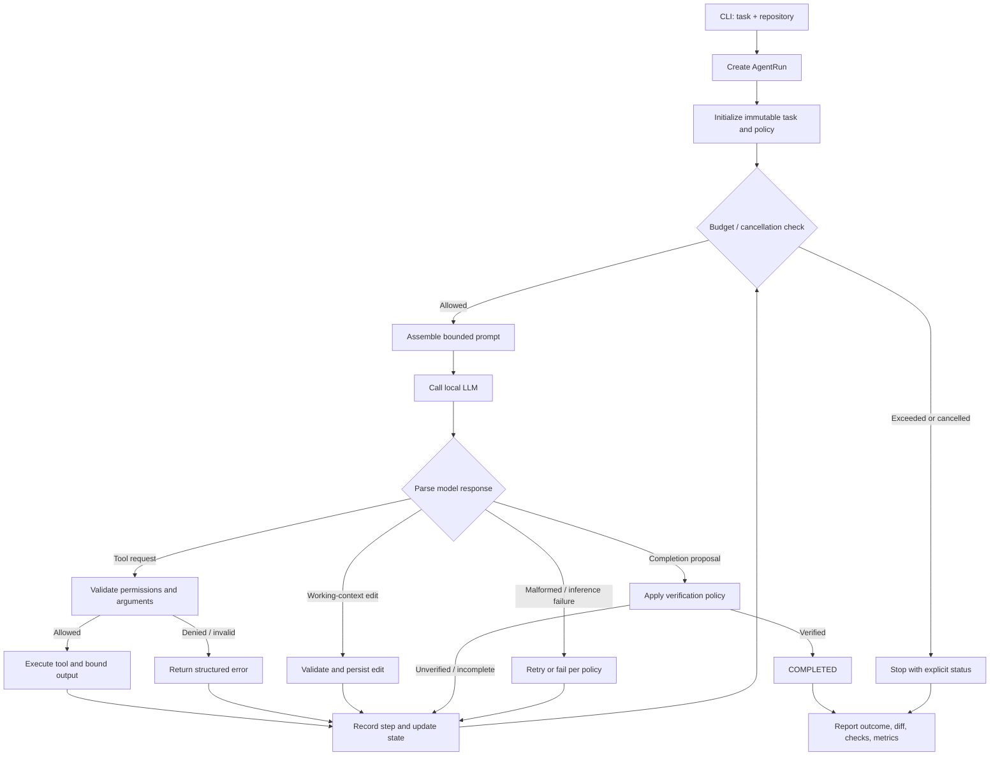
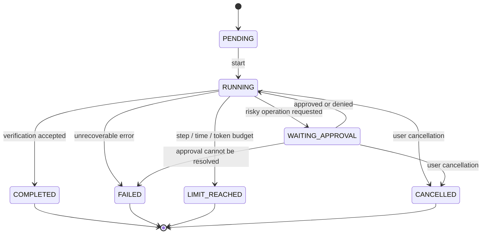

# Agent Runtime

> **Status:** Proposed technical specification — not yet implemented.  
> **Scope:** CLI-driven, single-process Python coding agent using a local llama.cpp model.  
> **Related:** [Architecture](architecture.md) · [Context and Memory](context-and-memory.md) · [Repository Retrieval](repository-retrieval.md) · [Benchmarking](benchmarking.md)

## 1. Purpose

The agent runtime is the **control plane** for one coding task. It repeatedly assembles context, requests a next action from the local LLM, validates and executes that action, records the result, and decides whether to continue. The **model proposes actions**; the **Python harness owns state, tool execution, permissions, budgets, and final status**.

A single `AgentRun` is one attempt to solve a task in one workspace with a pinned model, configuration, and context strategy. A run may contain many model calls and tool steps. It is not merely a log, nor is it the model itself.

### Design requirements

- Use the **same runtime** for baseline, retrieval-only, context-editing-only, and combined strategies.
- Keep the runtime independent of the underlying LLM server and context-management implementation.
- Support autonomous multi-step work without prompting the user after every safe action.
- Prevent unbounded execution and uncontrolled file/command access.
- Preserve enough evidence to diagnose failures and reproduce benchmarks.
- Never equate the model's assertion of success with verified success.

## 2. Execution overview



**Illustrative CLI** (not yet implemented):

```bash
harness run "Fix the failing authentication test" --repo ./example-repo
```

The runtime is non-deterministic in *which valid actions the model proposes*, but deterministic in *how those actions are validated, executed, logged, and limited*.

## 3. Run lifecycle and states



| State | Meaning |
| --- | --- |
| `PENDING` | Task created; execution has not begun |
| `RUNNING` | Runtime may call the model or execute an allowed action |
| `WAITING_APPROVAL` | A proposed action requires explicit human authorization |
| `COMPLETED` | Completion criteria satisfied under the configured verification policy |
| `FAILED` | Unrecoverable failure or no viable next action |
| `LIMIT_REACHED` | An execution budget was exhausted |
| `CANCELLED` | User stopped the run |

Terminal states are immutable for the MVP. Resuming a terminated or interrupted run is a future feature; traces alone do not guarantee resumability.

### Runtime-owned state

A proposed minimal state model:

```python
from dataclasses import dataclass, field
from enum import Enum
from pathlib import Path

class RunStatus(str, Enum):
    PENDING = "pending"
    RUNNING = "running"
    WAITING_APPROVAL = "waiting_approval"
    COMPLETED = "completed"
    FAILED = "failed"
    LIMIT_REACHED = "limit_reached"
    CANCELLED = "cancelled"

@dataclass
class AgentRun:
    run_id: str
    task: str                      # Immutable original request
    workspace: Path                # Canonical workspace root
    model_id: str
    strategy: str
    status: RunStatus = RunStatus.PENDING
    steps: int = 0
    model_calls: int = 0
    total_input_tokens: int = 0
    total_output_tokens: int = 0
    last_result: dict | None = None
    verification: dict = field(default_factory=dict)
```

This is an **interface sketch**, not a finalized database schema. Time budgets, cancellation flags, policy, and detailed event history may live in associated runtime objects.

## 4. Agent loop contract

The loop should be small and readable. Tool implementations, prompt construction, and persistence belong behind interfaces.

```python
def run_agent(run, context_manager, llm, tools, verifier, recorder, limits):
    run.status = RunStatus.RUNNING

    while run.status == RunStatus.RUNNING:
        stop_reason = limits.check(run)
        if stop_reason:
            run.status = stop_reason
            break

        prompt = context_manager.build(run)  # Must fit configured budget
        response = llm.generate(prompt)
        run.model_calls += 1
        limits.record_usage(run, response.usage)

        action = parse_response(response)

        if action.kind == "tool":
            result = tools.validate_and_execute(action, run.workspace)
            context_manager.observe(run, action, result)

        elif action.kind == "context_edit":
            result = context_manager.apply_edit(run, action)
            context_manager.observe(run, action, result)

        elif action.kind == "complete":
            result = verifier.check(run, action)
            if result.accepted:
                run.status = RunStatus.COMPLETED
            else:
                context_manager.observe(run, action, result)

        else:
            result = handle_invalid_response(action)

        recorder.record_step(run, action, result)
        run.steps += 1

    recorder.finish_run(run)
    return run
```

**Important:** This pseudocode omits production-level exception handling, asynchronous approval waiting, cancellation, and resource cleanup. In implementation, `try/finally` must persist the terminal state and clean up. Model failures and parse errors must be counted toward budgets even if no valid action is produced.

### Loop invariants

1. The original user task and harness safety instructions are immutable.
2. The model never directly invokes Python tools; it only emits requests.
3. Every requested action passes schema, workspace, and policy validation.
4. Tool output is bounded before entering the next prompt.
5. Each model call and tool outcome is traceable, including invalid requests.
6. Every iteration is subject to configured budgets and cancellation.
7. Only the runtime can assign terminal run statuses.

## 5. Model response protocol

For the MVP, support **one action per model turn** to simplify control and tracing. Later, multi-tool responses can be normalized into sequential actions with independent validation.

Normalized action variants:

- `tool`: invoke a named repository, edit, or test tool.
- `context_edit`: propose a change to editable working notes.
- `complete`: propose a final result with evidence.
- `invalid`: unparsable or unsupported response.

Example tool request (illustrative wire format):

```json
{
  "kind": "tool",
  "name": "read_file",
  "arguments": {
    "path": "src/auth.py",
    "start_line": 20,
    "end_line": 80
  }
}
```

A local coding model may support native tool calling or may require a constrained JSON response format. The **LLM adapter** converts either format into the normalized action type; the rest of the runtime should not depend on llama.cpp-specific response fields.

### Structured tool result

```json
{
  "tool": "read_file",
  "ok": true,
  "data": {
    "path": "src/auth.py",
    "start_line": 20,
    "end_line": 22,
    "content": "20: def authenticate(token):\n21:     ...\n22:     return user"
  },
  "truncated": false
}
```

Failures must be equally structured: `ok: false`, stable `error_code`, and a concise `message`. Do not return arbitrary Python tracebacks to the model.

## 6. Tool system

| Tool | Inputs (minimum) | Output | Safety / limits |
| --- | --- | --- | --- |
| `list_files` | Optional relative directory, pattern | Relative file paths | Ignore rules; result cap |
| `search_code` | Query, optional file filter | Line-referenced matches | Search timeout; output cap |
| `read_file` | Relative path, line range | Bounded numbered lines | Canonical path check; byte/line cap |
| `edit_file` | Relative path, patch or exact edit | Diff, changed paths | Validate target, patch applicability, policy |
| `run_tests` | Approved test target or preset | Exit code, bounded stdout/stderr | Allowlist, timeout, output cap |
| `update_context` | Edit operation, target, content | Accepted/rejected, new size | Only editable notes; size cap |
| `read_memory` | Task-scoped memory key | Selected note content | Scope and token limits |
| `save_memory` | Task-scoped key, content | Saved/rejected | Scope, atomic write, size cap |

### Dispatch pipeline

1. Parse response into a typed action.
2. Validate tool name and argument schema.
3. Resolve paths against the canonical workspace or designated harness-data root.
4. Check policy (automatic, approval required, or denied).
5. Execute with timeout and resource/output limits.
6. Normalize and log the result.
7. Return a bounded result to the context manager for the next model call.

**Security detail:** Reject absolute paths and `..` traversal, and account for symlinks when enforcing the workspace boundary. Avoid unrestricted `shell=True` execution. A workspace check is not a full OS sandbox: untrusted repositories and tests can execute code, so test execution requires an explicit trust/permission policy.

### Human approval

- Safe, bounded reads can be automatic.
- Edits within an authorized workspace may be automatic under a configured policy, with a visible diff.
- Destructive operations, external effects, or operations outside the authorized scope require approval or are denied.
- A denied action returns a structured policy result; it does not grant the model a bypass.
- The CLI should display the exact operation and affected paths before accepting approval.
- If no interactive approval channel is available, fail closed rather than silently approving.

## 7. Completion and verification

The model may **propose** completion, but cannot declare its own run successful.

A completion proposal should contain:

```json
{
  "kind": "complete",
  "summary": "Fixed token validation in src/auth.py",
  "changed_files": ["src/auth.py"],
  "verification_claims": ["tests/test_auth.py passed"]
}
```

The verifier compares claims against **recorded tool evidence**, not the model's prose. For example, a claimed passing test must match an actual successful test invocation after the relevant code edit.

### MVP verification policy

- Capture the final diff and changed paths.
- Check for unresolved tool errors and unapproved changes.
- For code modifications, require an appropriate successful check **after the latest modification**, when such a check is available.
- If tests are unavailable or insufficient, report `unverified` or `partially_verified` explicitly. Do not fabricate success.
- Completion means the configured policy was met; it is **not proof of semantic correctness**.

**Proposed distinction:** `COMPLETED` is a run state, while verification quality is separately recorded as `verified`, `partially_verified`, or `unverified`. Under a strict policy, only `verified` may lead to `COMPLETED`. Under a permissive policy, a run can finish with a qualified outcome; the benchmark must not count that as a passing task unless its external test oracle passes.

### No-progress handling

Track repeated identical tool calls, repeated unchanged patches, and repeated completion rejections. After a configurable threshold, prompt the model to change approach or terminate as `FAILED` / `LIMIT_REACHED`, according to the reason.

## 8. Budgets, stopping, and cancellation

The runtime enforces independent limits:

| Budget | Purpose |
| --- | --- |
| Maximum model calls | Prevent indefinite generation |
| Maximum total steps | Bound tool/context-edit cycles |
| Wall-clock timeout | Bound overall task duration |
| Maximum input/output tokens | Bound cumulative inference cost |
| Maximum prompt/context tokens | Fit model context window and RAM target |
| Per-tool timeout/output limit | Prevent hanging tests and enormous tool output |
| Maximum consecutive invalid actions | Detect model/tool-protocol incompatibility |
| Maximum no-progress streak | Detect loops |

**Initial numeric defaults are intentionally undecided.** Benchmarking should pin them before comparisons. A budget exceeded after a model response still stops the next action if execution would violate policy.

Cancellation should be checked between steps and propagated to long-running subprocesses. A forced termination may leave partial edits; the final report must show them. Automatic rollback is not an MVP guarantee.

## 9. Error handling

| Event | Runtime response |
| --- | --- |
| Tests fail | Return exit code and bounded output to the model; continue within budget |
| File not found | Return structured tool error; model may correct path |
| Invalid arguments | Reject action; count invalid response/step |
| Patch conflict | Return concise conflict context; model may re-read and retry |
| Policy denial | Do not execute; return denial or request approval |
| Model timeout | Retry with bounded policy, then `FAILED` if unresolved |
| Malformed model output | Retry or request valid format within invalid-action budget |
| Context too large | Apply deterministic context-budget fallback; if still too large, fail explicitly |
| Test subprocess hangs | Kill subprocess on timeout; return structured timeout |
| SQLite logging failure | Do not silently lose audit data; fail or switch to explicitly degraded logging policy |

A failed test is **task feedback**, not necessarily a failed run. A failed safety check must never be treated as permission to retry the same operation in a less restricted form.

## 10. Context and memory integration

The runtime calls a strategy interface rather than implementing context logic:

```python
class ContextStrategy:
    def build(self, run) -> list[dict]: ...
    def observe(self, run, action, result) -> None: ...
    def apply_edit(self, run, action): ...
```

Possible implementations:

- `BaselineContextStrategy`: bounded recent history plus task and tool definitions.
- `EditableContextStrategy`: immutable task plus model-editable `working.md`, selected findings, and recent results.
- Retrieval is a **separately configurable capability**, so it can be evaluated independently of editable context.

The runtime does not know how Tree-sitter ranks snippets or how Markdown is organized. It only sees validated results and context-strategy outputs.

Memory-edit requests are model proposals. The context manager validates and atomically applies them. Editing memory must not rewrite the immutable user task or full trace.

## 11. Observability and SQLite

SQLite is optional supporting storage. The runtime should emit structured events through a recorder interface:

- `run_started` / `run_finished`
- `model_request` / `model_response` / `model_error`
- `tool_requested` / `tool_result`
- `context_edit_requested` / `context_edit_result`
- `approval_requested` / `approval_resolved`
- `verification_result`
- `budget_exceeded` / `cancelled`

Minimum per-step fields: run ID, sequence, timestamp, action kind/name, status, duration, model token usage if reported, context size, and bounded references to inputs/outputs.

Record configuration identifiers (model, quantization, context capacity, strategy, retrieval settings, budget policy, code revision) at run start so benchmarks can reproduce a run. Peak unified RAM should be measured by a defined external/system measurement method, not inferred from token counts.

## 12. Interfaces and proposed module layout

```text
src/harness/
├── cli.py
├── agent/
│   ├── runtime.py       # Orchestration loop
│   ├── state.py         # RunStatus, AgentRun, step types
│   ├── protocol.py      # Normalized actions and results
│   ├── limits.py        # Budgets and cancellation
│   └── verification.py  # Completion checks
├── llm/
│   └── client.py        # llama.cpp HTTP adapter
├── context/
│   └── manager.py       # Strategy interface and prompt assembly
├── memory/
│   └── store.py         # Task-scoped Markdown notes
├── retrieval/
│   ├── search.py
│   └── repo_map.py
├── tools/
│   ├── dispatcher.py
│   └── coding.py
└── storage/
    └── database.py      # Optional SQLite recorder
```

These are proposed boundaries, not a requirement to create all files immediately.

## 13. Testing strategy

### Unit tests

- Valid and invalid state transitions.
- Tool schema validation and path traversal/symlink rejection.
- Step, time, token, and invalid-action budgets.
- Completion rejection without matching verification evidence.
- Malformed model output and retry limits.
- Context-edit rejection when immutable boundaries are targeted.

### Integration tests

Use a **fake deterministic LLM adapter** to drive the loop through a known sequence:

1. Search repository.
2. Read relevant file.
3. Apply a patch.
4. Run a passing test.
5. Propose completion.
6. Assert terminal status, diff, and recorded evidence.

Also test failing tests followed by recovery, denied tools, timeouts, cancellation, and exhausted budgets. Run a smaller smoke suite against an actual local GGUF model; these tests should not depend on a particular wording of the model's responses.

## 14. Baseline fairness rules

For a valid harness comparison, hold constant:

- Model file and quantization.
- llama.cpp configuration, including configured context capacity.
- Task/repository snapshot and test oracle.
- Available file-edit/test tools and permission policy.
- Runtime loop, stopping budgets, and verification policy.
- Hardware and measurement methodology.

Vary only the intended strategy: context editing, retrieval enhancement, or both. Context strategies may yield different numbers of calls or tokens—that difference is part of the result and must be reported.

## 15. Implementation milestones

1. Define `AgentRun`, `RunStatus`, normalized actions, and fake LLM interface.
2. Build a bounded loop with explicit termination and event recording.
3. Add workspace-safe read/search tools.
4. Add patch editing and controlled test execution.
5. Implement completion verification and failure recovery.
6. Add the llama.cpp HTTP adapter and local-model smoke tests.
7. Connect swappable context strategies and retrieval capabilities.
8. Add SQLite metrics and benchmark instrumentation.

## 16. Open decisions

- Initial GGUF coding model and supported response/tool-call format.
- Whether CLI approval is interactive or opt-in at run start.
- Concrete defaults for limits, retries, and no-progress detection.
- Exact patch representation and rollback expectations.
- Minimum verification required for a `COMPLETED` run.
- Whether the MVP exposes pause/resume (currently deferred).
- Precise recorder durability behavior when SQLite is unavailable.

**Implementation principle:** Keep the runtime simple, deterministic where it controls execution, and measurable. Our research differentiator belongs primarily in the **context and retrieval strategies**, not in a second, more complicated agent loop.
