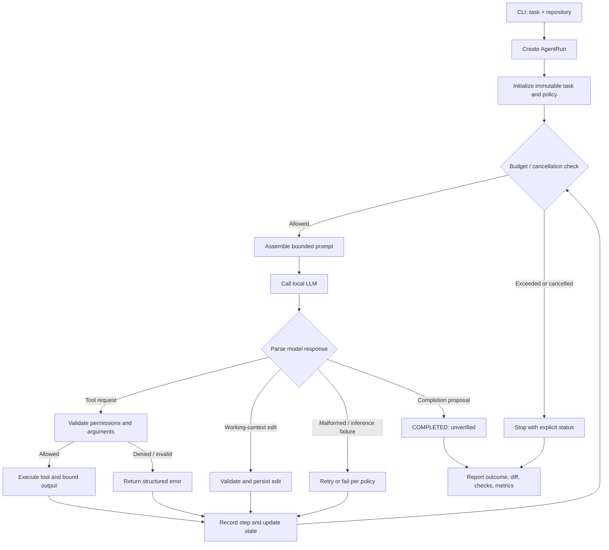
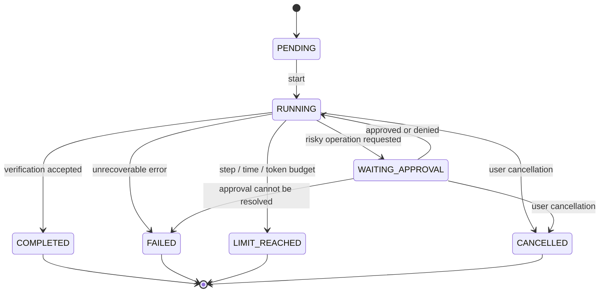

# Agent Runtime

> **Status:** The Phase 2 read-only CLI and Phase 3 bounded lexical `search_code` tool are implemented, with deterministic tests and local smoke evidence. Editing and runtime verification remain future work.
> **Scope:** CLI-driven, single-process Python coding agent using a local llama.cpp model.  
> **Related:** [Architecture](architecture.md) · [Context and Memory](context-and-memory.md) · [Repository Retrieval](repository-retrieval.md) · [Benchmarking](benchmarking.md)

## 1. Purpose

The agent runtime is the **control plane** for one coding task. It repeatedly assembles context, requests a next action from the local LLM, validates and executes that action, records the result, and decides whether to continue. The **model proposes actions**; the **Python harness owns state, tool execution, permissions, budgets, and final status**.

A single `AgentRun` is one attempt to solve a task in one workspace with a pinned model, configuration, and context strategy. A run may contain many model calls and tool steps. It is not merely a log, nor is it the model itself.

### Design requirements

- Use the **same runtime** for baseline, retrieval-only, context-editing-only, and combined strategies.
- Keep the runtime independent of the underlying LLM server and context-management implementation.
- Support autonomous multi-step work without prompting the user after every safe action.
- Prevent unbounded execution and uncontrolled file/command access.
- Preserve enough evidence to diagnose failures and reproduce benchmarks.
- Never equate the model's assertion of success with verified success.

## 2. Execution overview



**Implemented CLI:**

```bash
harness run "Fix the failing authentication test" --repo ./example-repo
```

The runtime is non-deterministic in *which valid actions the model proposes*, but deterministic in *how those actions are validated, executed, logged, and limited*.

## 3. Run lifecycle and states



| State | Meaning |
| --- | --- |
| `PENDING` | Task created; execution has not begun |
| `RUNNING` | Runtime may call the model or execute an allowed action |
| `WAITING_APPROVAL` | A proposed action requires explicit human authorization |
| `COMPLETED` | The model proposed an answer; no independent verification is performed |
| `FAILED` | Unrecoverable failure or no viable next action |
| `LIMIT_REACHED` | An execution budget was exhausted |
| `CANCELLED` | User stopped the run |

Terminal states are immutable for the MVP. Resuming a terminated or interrupted run is a future feature; traces alone do not guarantee resumability.

### Runtime-owned state

The implemented Phase 2 state contract is:

```python
from dataclasses import dataclass
from enum import Enum
from pathlib import Path

class RunStatus(str, Enum):
    PENDING = "pending"
    RUNNING = "running"
    WAITING_APPROVAL = "waiting_approval"
    COMPLETED = "completed"
    FAILED = "failed"
    LIMIT_REACHED = "limit_reached"
    CANCELLED = "cancelled"

@dataclass
class AgentRun:
    task: str
    workspace: Path
    status: RunStatus = RunStatus.PENDING
    steps: int = 0
    model_calls: int = 0
    final_response: str | None = None
    stop_reason: str | None = None

    def transition_to(self, status: RunStatus) -> None: ...
```

`task` and `workspace` are required at construction. `steps` and `model_calls` are ordinary mutable runtime-owned counters. `transition_to` permits `pending → running` and `running → completed`, `failed`, `limit_reached`, or `cancelled`; every other transition raises `ValueError`. `waiting_approval` is represented as a status for the later approval workflow, but this Phase 2 contract has no transition into or out of it. Terminal statuses cannot be reopened. Run identifiers, model configuration, token usage, evidence, and persistence belong to later runtime work.

### Normalized action protocol

The implemented `parse_action(text: str) -> Action` accepts exactly one JSON object, with surrounding whitespace allowed. The supported envelopes are `{"kind":"tool","name":"...","arguments":{...}}` and `{"kind":"complete","summary":"..."}`. Each object must have exactly its listed keys; tool names and completion summaries must be non-blank strings, and arguments must be an object. Unknown tool names are accepted by parsing and returned as structured dispatcher errors by the loop. Duplicate keys at any nesting depth, non-standard numeric constants, extra text, multiple values, malformed JSON, unknown action kinds, and wrong field types produce `InvalidAction` instead of raising. A completion action is only a model proposal and parsing it does not change run state. The `invalid` discriminator exists on `InvalidAction` as the parser's normalized error result; model-supplied `kind: "invalid"` is unsupported input.

## 4. Agent loop contract

`harness.agent.runtime.run_agent()` implements the read-only loop described below with an injected model callable and independent budgets for model attempts, processed steps, consecutive invalid actions, request duration, total run duration, prompt bytes, and model response bytes. Its pinned prompt describes separate `list_files`, `search_code`, `read_file`, and `complete` JSON schemas, prohibits Markdown fences, and directs the model to use listing for path-only questions and file reads when contents are requested. It explains that `pattern` uses `Path.match` glob syntax rather than regular expressions and that an empty filtered listing should be retried with a simpler or unfiltered request. The prompt's next-action directive is included in the byte budget after the retained history. Invalid responses are observed with corrective feedback that repeats the exact `read_file` schema and clarifies that the tool name belongs in `name`; the original response excerpt remains capped at 1 KiB. The `run` CLI sends the separate `READ_ONLY_SYSTEM_PROMPT` system message and binds a JSON Schema for both tool requests and completion to the llama.cpp client's `response_format`. It subtracts the system message's UTF-8 byte length from the user-prompt budget, keeping both message contents within the default 24 KiB cap. `run_agent()`'s injected model contract remains `model(prompt, *, timeout=seconds)`; custom callables still receive no schema or system-message argument. Generation constraints do not replace strict parsing, dispatcher validation, or independent verification. A typed transport or timeout error gets one immediate retry using the same prompt; malformed server responses are not retried. A model `complete` action ends the run as `COMPLETED` with `stop_reason="model_complete"`; this is an unverified model proposal, not evidence of correctness. Prompt byte limits do not guarantee a model token limit. Schema-constrained JSON requires a compatible llama.cpp server build; see the [server API documentation](https://github.com/ggml-org/llama.cpp/blob/master/tools/server/README.md#post-v1chatcompletions-openai-compatible-chat-completions-api).

```python
run_agent(
    task: str,
    workspace: Path,
    *,
    model: Callable[..., ChatResponse] = chat,
    max_model_calls: int = 20,
    max_steps: int = 20,
    max_consecutive_invalid_actions: int = 3,
    request_timeout: float = 120,
    run_timeout: float = 300,
    max_prompt_bytes: int = 24576,
    max_model_response_bytes: int = 65536,
    cancelled: Callable[[], bool] | None = None,
) -> AgentRun
```

Injected models must accept `model(prompt, *, timeout=seconds)` and honor the cooperative request timeout; the runtime cannot forcibly stop a custom callable. Numeric budgets must be positive integers, timeouts finite and positive, and booleans are rejected. Safe-boundary checks run before inference, after model success or failure, and before/after tools and completion. Cancellation takes precedence over the run deadline, which takes precedence over completion. Only a successful completion action sets `final_response`. Model-call counts include retries; steps include invalid actions and oversized response text, but not failures or oversized HTTP bodies. Cancellation is local and cooperative; it is not propagated to a subprocess or forcibly terminate a model request.

### Loop invariants

1. The original user task and harness safety instructions are immutable.
2. The model never directly invokes Python tools; it only emits requests.
3. Every requested action passes schema, workspace, and policy validation.
4. Tool output is bounded before entering the next prompt.
5. Each model call and tool outcome is traceable, including invalid requests.
6. Every iteration is subject to configured budgets and cancellation.
7. Only the runtime can assign terminal run statuses.

## 5. Model response protocol

For the MVP, support **one action per model turn** to simplify control and tracing. Later, multi-tool responses can be normalized into sequential actions with independent validation.

Normalized action variants:

- `tool`: invoke a named repository, edit, or test tool.
- `context_edit`: propose a change to editable working notes.
- `complete`: propose a final result with evidence.
- `invalid`: unparsable or unsupported response.

Example tool request (illustrative wire format):

```json
{
  "kind": "tool",
  "name": "read_file",
  "arguments": {
    "path": "src/auth.py",
    "start_line": 20,
    "end_line": 80
  }
}
```

A local coding model may support native tool calling or may require a constrained JSON response format. The **LLM adapter** converts either format into the normalized action type; the rest of the runtime should not depend on llama.cpp-specific response fields.

### Structured tool result

```json
{
  "tool": "read_file",
  "ok": true,
  "data": {
    "path": "src/auth.py",
    "start_line": 20,
    "end_line": 22,
    "content": "20: def authenticate(token):\n21:     ...\n22:     return user"
  },
  "truncated": false
}
```

Failures must be equally structured: `ok: false`, stable `error_code`, and a concise `message`. Do not return arbitrary Python tracebacks to the model.

## 6. Tool system

| Tool | Inputs (minimum) | Output | Safety / limits |
| --- | --- | --- | --- |
| `list_files` | Optional relative directory, pattern | Relative file paths | Ignore rules; result cap |
| `search_code` | Query, optional file filter | Line-referenced matches | Search timeout; output cap |
| `read_file` | Relative path, line range | Bounded numbered lines | Canonical path check; byte/line cap |
| `edit_file` | Relative path, patch or exact edit | Diff, changed paths | Validate target, patch applicability, policy |
| `run_tests` | Approved test target or preset | Exit code, bounded stdout/stderr | Allowlist, timeout, output cap |
| `update_context` | Edit operation, target, content | Accepted/rejected, new size | Only editable notes; size cap |
| `read_memory` | Task-scoped memory key | Selected findings/note content | Scope and token limits |

### Implemented read-only tools

`harness.tools.dispatcher.execute_tool(action: ToolAction, workspace: Path) -> ToolResult`
currently dispatches `list_files`, `search_code`, and `read_file`. It validates exact field
sets and value types before resolving the workspace, and returns a frozen
`ToolResult(tool, ok, data, truncated, error_code, message)`. Call
`to_dict()` for its JSON-ready representation; the serialized result is capped
at 32 KiB. Unsupported names and malformed requests return controlled errors.

- `list_files` accepts optional `directory="."` and a positive `pattern` glob.
  It invokes `rg --files --null` with a fixed argument list, honors repository
  ignore rules (including non-Git `.ignore` / `.gitignore` fixtures), and
  disables user ripgrep config and global Git excludes. The pattern is applied
  to discovered workspace-relative paths with Python `Path.match`, not as a
  regular expression; for example, `*.py` matches Python files and a literal
  `settings.py` pattern matches that name. A pipe does not express alternation:
  search for `settings.py` and `greeting.py` in separate calls. An empty
  filtered result is not proof that a path is absent; retry with a simpler
  pattern or no pattern. A listing is sufficient evidence for path-only
  questions; use `read_file` when file contents are requested. Patterns cannot
  reveal ignored paths. Hidden paths and `node_modules`, `.venv`,
  `__pycache__`, `dist`, and `build` are excluded even when a pattern matches.
  Results are sorted and limited to 200 paths, 64 KiB of ripgrep output, and
  five seconds.
- `search_code` requires a nonblank single-line regex `query` (up to 4096 UTF-8
  bytes), with optional positive `Path.match` filename `glob` and `max_results`
  from 1 to 200 (default 50). It preflights the regex against empty stdin, then
  searches visible files up to 1 MiB with a shared five-second deadline.
  Results contain relative `path`, 1-based `line`, and a UTF-8 `preview` capped
  at 512 bytes. Match-count and byte caps stop the subprocess; stdout is capped
  at 64 KiB and stderr at 4 KiB. Partial capped events are discarded, and
  omitted results or clipped previews set `truncated`. Unsupported UTF-8
  previews are skipped. Empty success, invalid regex, unavailable ripgrep,
  timeout, and execution errors remain distinct. Queries use regex syntax;
  filename globs filter after discovery and cannot override ignore rules.
- `read_file` requires a relative `path`, with optional positive integer
  `start_line` and `end_line` (inclusive). The default range is at most 200
  lines from `start_line` (default 1). It accepts regular UTF-8 text files up
  to 1 MiB, rejects NUL bytes, and returns line-numbered content capped at
  16 KiB. Metadata includes the relative path, byte size, total line count,
  and actual returned line bounds; an empty range has null bounds. `truncated`
  is true when a nonempty file is only partly returned, including a range past
  EOF. The action schema allows positive integer line values without an
  artificial maximum; dispatcher validation requires `end_line >= start_line`
  and a requested range of at most 200 lines.

The repository tools resolve the workspace and target canonically, reject absolute paths,
`..` components, and symlink escapes, and permit symlinks that resolve inside
the workspace. Explicit reads can access hidden or ignored files. The boundary
does not defend against hostile concurrent filesystem mutation between checks
and reads; it is not an OS sandbox. These tools do not write files or execute
repository code. `list_files` and `search_code` require `rg` on `PATH`.

`update_context` is the MVP write interface for working notes; a separate `save_memory` tool is deferred. The model-facing `update_context` request is normalized by the LLM adapter into the runtime's `context_edit` action kind. Keep the core repository tool interface common across retrieval strategies; symbol maps and ranking can initially be implemented behind `search_code` and `read_file`.

### Dispatch pipeline

1. Parse response into a typed action.
2. Validate tool name and argument schema.
3. Resolve paths against the canonical workspace or designated harness-data root.
4. Check policy (automatic, approval required, or denied).
5. Execute with timeout and resource/output limits.
6. Normalize and log the result.
7. Return a bounded result to the context manager for the next model call.

**Security detail:** Reject absolute paths and `..` traversal, and account for symlinks when enforcing the workspace boundary. Avoid unrestricted `shell=True` execution. A workspace check is not a full OS sandbox: untrusted repositories and tests can execute code, so test execution requires an explicit trust/permission policy.

### Human approval

- Safe, bounded reads can be automatic.
- Edits within an authorized workspace may be automatic under a configured policy, with a visible diff.
- Destructive operations, external effects, or operations outside the authorized scope require approval or are denied.
- A denied action returns a structured policy result; it does not grant the model a bypass.
- The CLI should display the exact operation and affected paths before accepting approval.
- If no interactive approval channel is available, fail closed rather than silently approving.

## 7. Completion and verification

The model may **propose** completion, but cannot declare its own run successful.

A completion proposal should contain:

```json
{
  "kind": "complete",
  "summary": "Fixed token validation in src/auth.py",
  "changed_files": ["src/auth.py"],
  "verification_claims": ["tests/test_auth.py passed"]
}
```

The verifier compares claims against **recorded tool evidence**, not the model's prose. For example, a claimed passing test must match an actual successful test invocation after the relevant code edit.

### MVP verification policy

- Capture the final diff and changed paths.
- Check for unresolved tool errors and unapproved changes.
- For code modifications, require an appropriate successful check **after the latest modification**, when such a check is available.
- If tests are unavailable or insufficient, report `unverified` or `partially_verified` explicitly. Do not fabricate success.
- Completion means the configured policy was met; it is **not proof of semantic correctness**.

**Canonical distinction:** A model's `complete` action is a **completion proposal**, not a success verdict. `COMPLETED` is a **runtime terminal state** granted under the configured verification policy; record verification quality separately as `verified`, `partially_verified`, or `unverified`. Under a strict coding policy, only verified evidence permits `COMPLETED`; permissive informational runs may end with a qualified, non-benchmark outcome. **Benchmark resolution is separate** and is determined only by the independent task oracle, never by the model's claim or the runtime status.

### No-progress handling

Track repeated identical tool calls, repeated unchanged patches, and repeated completion rejections. After a configurable threshold, prompt the model to change approach or terminate as `FAILED` / `LIMIT_REACHED`, according to the reason.

## 8. Budgets, stopping, and cancellation

The runtime currently enforces the following budgets:

| Budget | Purpose |
| --- | --- |
| Maximum model calls | Prevent indefinite generation |
| Maximum total steps | Bound tool/context-edit cycles |
| Wall-clock timeout | Bound overall task duration |
| Maximum consecutive invalid actions | Detect model/tool-protocol incompatibility |
| Maximum prompt and model response bytes | Bound UTF-8 request/response text |

Token-based limits, per-tool execution timeouts, and no-progress limits remain
future work. Repository tools have their own existing output limits.

The implemented defaults are 20 model attempts, 20 processed steps, 3 consecutive invalid actions, 120 seconds per request, 300 seconds per run, 24,576 prompt bytes, and 65,536 response bytes. Benchmarking should pin these settings before comparisons. A completion on the final allowed call or step is accepted if cancellation and the deadline permit it. Invalid tool/protocol actions advance the invalid streak; other processed responses reset it. A budget exceeded after a model response stops a further action if execution would violate policy.

The optional cancellation callback is checked at safe boundaries; cancellation is not currently propagated to long-running subprocesses. A forced termination may leave partial edits; the final report must show them. Automatic rollback is not an MVP guarantee.

## 9. Error handling

| Event | Runtime response |
| --- | --- |
| Tests fail | Return exit code and bounded output to the model; continue within budget |
| File not found | Return structured tool error; model may correct path |
| Invalid arguments | Reject action; count invalid response/step |
| Patch conflict | Return concise conflict context; model may re-read and retry |
| Policy denial | Do not execute; return denial or request approval |
| Model timeout | Retry with bounded policy, then `FAILED` if unresolved |
| Malformed model output | Retry or request valid format within invalid-action budget |
| Context too large | Apply deterministic context-budget fallback; if still too large, fail explicitly |
| Test subprocess hangs | Kill subprocess on timeout; return structured timeout |
| SQLite logging failure | Do not silently lose audit data; fail or switch to explicitly degraded logging policy |

A failed test is **task feedback**, not necessarily a failed run. A failed safety check must never be treated as permission to retry the same operation in a less restricted form.

## 10. Context and memory integration

The runtime calls a strategy interface rather than implementing context logic:

```python
class ContextStrategy:
    def build(self, run) -> list[dict]: ...
    def observe(self, run, action, result) -> None: ...
    def apply_edit(self, run, action): ...
```

Possible implementations:

- `BaselineContextStrategy`: bounded recent history plus task and tool definitions.
- `EditableContextStrategy`: immutable task plus model-editable `working.md`, selected findings, and recent results.
- Retrieval is a **separately configurable capability**, so it can be evaluated independently of editable context.

The runtime does not know how Tree-sitter ranks snippets or how Markdown is organized. It only sees validated results and context-strategy outputs.

Memory-edit requests are model proposals. The context manager validates and atomically applies them. Editing memory must not rewrite the immutable user task or full trace.

## 11. Observability and SQLite

SQLite is optional supporting storage. The runtime should emit structured events through a recorder interface:

- `run_started` / `run_finished`
- `model_request` / `model_response` / `model_error`
- `tool_requested` / `tool_result`
- `context_edit_requested` / `context_edit_result`
- `approval_requested` / `approval_resolved`
- `verification_result`
- `budget_exceeded` / `cancelled`

Minimum per-step fields: run ID, sequence, timestamp, action kind/name, status, duration, model token usage if reported, context size, and bounded references to inputs/outputs.

Record configuration identifiers (model, quantization, context capacity, strategy, retrieval settings, budget policy, code revision) at run start so benchmarks can reproduce a run. Peak unified RAM should be measured by a defined external/system measurement method, not inferred from token counts.

## 12. Interfaces and proposed module layout

```text
src/harness/
├── cli.py
├── agent/
│   ├── runtime.py       # Orchestration loop
│   ├── state.py         # RunStatus, AgentRun, step types
│   ├── protocol.py      # Normalized actions and results
│   ├── limits.py        # Budgets and cancellation
│   └── verification.py  # Completion checks
├── llm/
│   └── client.py        # llama.cpp HTTP adapter
├── context/
│   └── manager.py       # Strategy interface and prompt assembly
├── memory/
│   └── store.py         # Task-scoped Markdown notes
├── retrieval/
│   ├── search.py
│   └── repo_map.py
├── tools/
│   ├── dispatcher.py
│   └── coding.py
└── storage/
    └── database.py      # Optional SQLite recorder
```

These are proposed boundaries, not a requirement to create all files immediately.

## 13. Testing strategy

### Unit tests

- Valid and invalid state transitions.
- Tool schema validation and path traversal/symlink rejection.
- Step, time, token, and invalid-action budgets.
- Completion rejection without matching verification evidence.
- Malformed model output and retry limits.
- Context-edit rejection when immutable boundaries are targeted.

### Integration tests

Use a **fake deterministic LLM adapter** to drive the loop through a known sequence:

1. Search repository.
2. Read relevant file.
3. Apply a patch.
4. Run a passing test.
5. Propose completion.
6. Assert terminal status, diff, and recorded evidence.

Also test failing tests followed by recovery, denied tools, timeouts, cancellation, and exhausted budgets. Run a smaller smoke suite against an actual local GGUF model; these tests should not depend on a particular wording of the model's responses.

## 14. Baseline fairness rules

For a valid harness comparison, hold constant:

- Model file and quantization.
- llama.cpp configuration, including configured context capacity.
- Task/repository snapshot and test oracle.
- Available file-edit/test tools and permission policy.
- Runtime loop, stopping budgets, and verification policy.
- Hardware and measurement methodology.

Vary only the intended strategy: context editing, retrieval enhancement, or both. Context strategies may yield different numbers of calls or tokens—that difference is part of the result and must be reported.

## 15. Implementation milestones

The phase ordering in [Development Roadmap](development-roadmap.md) is authoritative. The milestones below describe runtime-specific work that is distributed across its Phases 2–4; they are not a competing project schedule.

1. Define `AgentRun`, `RunStatus`, normalized actions, and fake LLM interface.
2. Build a bounded loop with explicit termination and event recording.
3. Add workspace-safe read/search tools.
4. Add patch editing and controlled test execution.
5. Implement completion verification and failure recovery.
6. Add the llama.cpp HTTP adapter and local-model smoke tests.
7. Connect swappable context strategies and retrieval capabilities.
8. Add SQLite metrics and benchmark instrumentation.

## 16. Open decisions

- Initial GGUF coding model and supported response/tool-call format.
- Whether CLI approval is interactive or opt-in at run start.
- Concrete defaults for limits, retries, and no-progress detection.
- Exact patch representation and rollback expectations.
- Minimum verification required for a `COMPLETED` run.
- Whether the MVP exposes pause/resume (currently deferred).
- Precise recorder durability behavior when SQLite is unavailable.

**Implementation principle:** Keep the runtime simple, deterministic where it controls execution, and measurable. Our research differentiator belongs primarily in the **context and retrieval strategies**, not in a second, more complicated agent loop.
