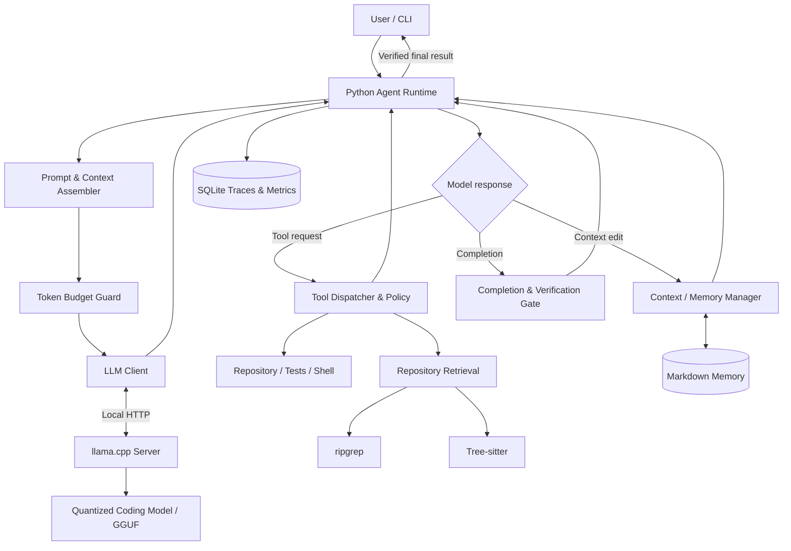
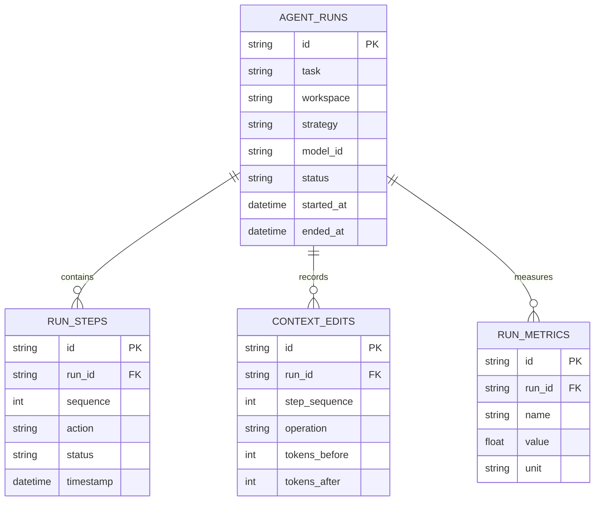
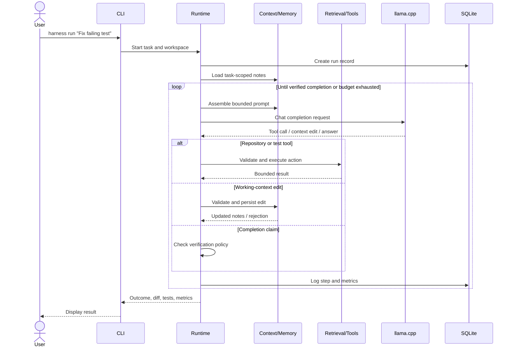

# Architecture

> **Status:** Proposed design — not yet implemented.  
> **Target:** 16 GB Apple Silicon MacBook Air; local-first, CLI-first coding agent.

## 1. Purpose and design goals

Efficient Code Agent is a Python coding-agent harness that orchestrates a small, quantized local LLM to inspect, modify, and verify source code. Its central research question is whether **better context selection and self-editing working memory improve coding-task success at a fixed hardware budget**.

### Goals

- Run locally without cloud inference or a mandatory web service.
- Prioritize **correct task completion** over raw generation speed.
- Keep active context useful and bounded through CLM-inspired model-initiated edits.
- Retrieve relevant repository code without injecting the whole codebase.
- Make all tool operations, context changes, and outcomes observable and reproducible.
- Support fair baseline-versus-optimized comparisons using the same model and tasks.
- Work within practical unified-memory constraints on a 16 GB MacBook Air.

### Non-goals for the MVP

- Training or fine-tuning an LLM.
- Implementing a new inference engine or custom KV-cache algorithms.
- Cloud deployment, multi-user hosting, or distributed workers.
- React/FastAPI UI, vector database, or separate LLM summarization subsystem.
- Autonomous network access or unrestricted shell execution.

## 2. Technology stack

| Component | Technology | Responsibility |
| --- | --- | --- |
| CLI and orchestration | Python | User commands, run lifecycle, agent loop |
| Local inference | llama.cpp (`llama-server`) | Execute GGUF quantized coding models |
| Code search | ripgrep (`rg`) | Fast lexical and filename search |
| Syntax parsing | Tree-sitter | Extract code structure and symbols |
| Working and persistent notes | Markdown | Editable task context and findings |
| Run tracing and evaluation | SQLite | Supporting execution logs, metrics, experiment metadata |
| Tests | pytest | Harness tests and evaluation infrastructure |

FastAPI and React are optional future interfaces. They are **not** required for the initial CLI implementation.

## 3. High-level component architecture



The **harness calls the model**, not vice versa. A model-generated tool call is a proposal; Python validates and executes it. The result becomes input to a subsequent inference call. The model does not directly write files or execute commands.

## 4. Component responsibilities

### 4.1 CLI

- Accept a task and workspace path.
- Start or inspect runs; report progress and final status.
- Expose strategy settings (baseline vs. optimized), model endpoint, and budgets.
- Keep the CLI as a thin interface; business logic belongs in the runtime.

**Illustrative command (not implemented):**

```bash
harness run "Fix the failing authentication test" --repo ./sample-repo
```

### 4.2 Agent runtime

- Create a run, initialize task state, and execute the agent loop.
- Dispatch validated model requests to tools or context-edit handlers.
- Track step/time/token budgets, tool failures, and completion.
- Distinguish model-declared completion from verified completion.
- Persist an append-only record of events for diagnosis and evaluation.

The runtime is **model-agnostic** and depends on an LLM client interface rather than llama.cpp-specific code.

### 4.3 LLM client and llama.cpp

- Start `llama-server` separately (or optionally launch/manage it in a future version).
- Send chat-completion requests over local HTTP.
- Normalize generated text and structured tool calls into harness-level response types.
- Collect reported token usage and timings where available.
- Handle malformed responses, timeouts, and inference errors.

The first implementation should choose a **specific GGUF coding model and compatible tool-call format**, then test that it reliably produces parseable actions. Model selection is a benchmark variable, not an architectural dependency.

### 4.4 Prompt and context assembler

Each inference request is assembled from distinct sources:

1. **Immutable harness instructions and tool specifications.**
2. **Original user task and current constraints.**
3. **Recent action/result information** needed for continuity.
4. **Editable working context**, loaded from task-scoped Markdown.
5. **Selected repository snippets and saved findings** relevant to the next action.

The assembler controls which information enters the model's active context. Stored history is **not** automatically replayed in full.

### 4.5 CLM-inspired context manager

- Offer model-initiated operations to replace, append, or prune its **editable working context**.
- Validate edits against size limits and task/workspace boundaries.
- Never allow memory-edit operations to change immutable instructions, original task, or raw execution logs.
- Persist accepted edits between model calls.
- Apply a **deterministic budget fallback** when the model fails to maintain a small enough context.

There is no separate LLM-based summarization service in the MVP. Proactive context editing is the primary strategy; fallback pruning is a guardrail, not a second autonomous memory agent.

### 4.6 Repository retrieval

- Use ripgrep to locate text, filenames, and code references.
- Use Tree-sitter to identify functions, classes, symbols, and structural boundaries.
- Produce compact repository maps and return bounded, line-referenced snippets.
- Rank results using lightweight heuristics: direct name match, symbol relevance, file proximity, and task context.
- Respect ignore rules and avoid indiscriminate ingestion of binaries, generated files, and secrets.

Tree-sitter provides syntax trees; the harness builds any human-/model-readable repository map from those trees. Dependency and call relationships are best-effort, not full static semantic analysis.

### 4.7 Coding tools and policy

Initial tool categories:

| Tool | Intent | Safeguards |
| --- | --- | --- |
| `list_files` | Discover workspace files | Workspace scope, ignore rules |
| `search_code` | Find relevant text/symbols | Result and token limits |
| `read_file` | Inspect a bounded file region | Path validation, line limits |
| `edit_file` | Apply a proposed patch | Workspace scope, diff review/log |
| `run_tests` | Verify changes | Timeout, bounded output |
| `update_context` | Modify editable working notes | Context-only paths, size validation |
| `read_memory` / `save_memory` | Retrieve/store task findings | Scoped paths, size validation |

Do not give the model unrestricted access to the host shell. The MVP should favor explicit tools and allowlisted test commands. File modifications should be recorded and validated; higher-risk operations should require user approval.

### 4.8 Markdown memory

**Markdown is task state, not an alternative inference engine.** Files live on disk and only consume LLM context when selected by the assembler.

Proposed task-scoped layout (exact storage location to be finalized):

```text
.harness/
  runs/
    <run-id>/
      working.md
      task.md
      findings/
        ...
```

- `working.md`: concise, model-editable active notes.
- `task.md`: durable task goals, constraints, and progress; original request retained separately and immutably.
- `findings/`: detailed, selectively retrieved observations.

The harness owns file I/O, atomic writes, validation, and versioning. Generated harness data should be ignored by the target repository's Git tracking or stored outside the workspace. Memory from different runs must not silently leak between tasks.

### 4.9 SQLite tracing and metrics

SQLite is a **supporting component**, not required for the core agent loop. It stores structured execution and benchmark data; Markdown stores the agent's editable notes.

Proposed minimum schema:



Detailed tool payloads and large logs may be stored as bounded artifacts on disk with references from SQLite. Resuming interrupted runs is a possible later feature, **not guaranteed by logging alone**.

## 5. End-to-end task lifecycle



**Example:** The agent searches for a failing symbol, reads relevant code, identifies a likely bug, edits a file, runs a test, and either corrects the change or reports a verified result. Between iterations, the model may update `working.md` to retain the root cause and discard outdated guesses.

## 6. Context, memory, and unified RAM

The harness manages **logical context**; llama.cpp manages **inference memory**.

- Markdown and SQLite are disk-backed and typically have little direct RAM impact.
- Prompt tokens become part of the model's active context and can affect inference cost and KV-cache demand.
- Model weights, KV cache, runtime buffers, Python, and macOS share the machine's memory budget.
- Shorter prompts do **not automatically** reduce allocated KV-cache RAM if the server reserves a fixed context capacity.

Evaluation must measure **actual peak unified-memory usage** as well as context token counts. Compare baseline and optimized strategies at **the same configured context window** before claiming RAM or accuracy benefits.

## 7. Baseline and optimized operating modes

A controlled comparison requires a common runtime, model, tools, verification policy, and task suite.

| Capability | Baseline | Optimized variants |
| --- | --- | --- |
| Agent loop and file/test tools | Yes | Same |
| Local model and context limit | Fixed | Same |
| Context selection | Simple bounded recent history | CLM-inspired editable working context |
| Repository search | Basic file/text tools | Tree-sitter maps and ranked snippets |
| SQLite tracing | Yes | Same |
| Verification | Same policy | Same policy |

Run ablations: baseline, retrieval only, context editing only, and combined. Measure **task success rate** first; also record token use, step count, elapsed time, and peak RAM. Do not assume an optimization improves accuracy until results support it.

## 8. Safety and reliability boundaries

- Restrict file access and modifications to a canonicalized workspace root.
- Exclude secrets and ignored/generated files from automatic retrieval when practical.
- Treat repository content and tool output as **untrusted data**, not new system instructions.
- Enforce tool timeouts, output caps, maximum steps, and overall task budgets.
- Preserve original user instructions and an immutable action log.
- Require confirmation for destructive or out-of-scope operations.
- Make failures visible; do not report a task as successful solely because the model says it is.

## 9. Proposed Python package layout

```text
efficient-code-agent/
├── README.md
├── docs/
│   ├── architecture.md
│   ├── agent-runtime.md
│   ├── context-and-memory.md
│   ├── repository-retrieval.md
│   ├── benchmarking.md
│   └── development-roadmap.md
├── src/
│   └── harness/
│       ├── cli.py
│       ├── agent/
│       │   └── runtime.py
│       ├── llm/
│       │   └── client.py
│       ├── context/
│       │   └── manager.py
│       ├── memory/
│       │   └── store.py
│       ├── retrieval/
│       │   ├── search.py
│       │   └── repo_map.py
│       ├── tools/
│       │   ├── dispatcher.py
│       │   └── coding.py
│       └── storage/
│           └── database.py
├── tests/
├── benchmarks/
└── pyproject.toml
```

Directories and module names are provisional. Avoid creating empty modules before their interfaces are needed.

## 10. Implementation sequence

1. **Baseline foundation:** Python package, CLI, llama.cpp client, minimal agent loop, bounded read/search/test tools.
2. **Safe coding workflow:** Patch application, workspace safeguards, completion verification, integration tests.
3. **Baseline measurement:** Reproducible tasks, event logs, token/time/RAM capture.
4. **Editable context:** Task-scoped Markdown memory, model-initiated edits, immutable prompt boundaries, budget fallback.
5. **Code-aware retrieval:** ripgrep integration, Tree-sitter parsing, repository map, snippet ranking.
6. **Structured evaluation:** SQLite traces, baseline/optimized ablations, documented results.

## 11. Open design decisions

These should be resolved in their dedicated design documents before implementation:

- Initial local coding model, quantization, and supported tool-call format.
- Default context window and total run budgets.
- Whether working context is sent in full each step or selectively assembled.
- Exact schema and permissions for model-initiated context edits.
- Workspace-safe patch and test execution strategy.
- Memory directory placement and task/run scoping.
- Evaluation dataset, test oracle, and fair RAM-measurement methodology.

---

**Related documents (planned):** [Agent Runtime](agent-runtime.md) · [Context and Memory](context-and-memory.md) · [Repository Retrieval](repository-retrieval.md) · [Benchmarking](benchmarking.md) · [Development Roadmap](development-roadmap.md).
