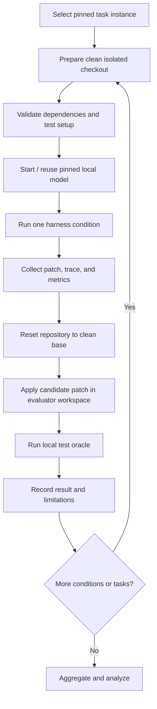

# Benchmarking and Evaluation

> **Status:** Proposed evaluation plan — no benchmark results have been collected.  
> **Target hardware:** 16 GB Apple Silicon MacBook Air.  
> **Primary objective:** Determine whether retrieval and CLM-inspired editable context improve coding-task success for small local models under comparable resource limits.  
> **Related:** [Architecture](architecture.md) · [Agent Runtime](agent-runtime.md) · [Context and Memory](context-and-memory.md) · [Repository Retrieval](repository-retrieval.md)

## 1. Research questions

1. Does the optimized harness solve more real coding issues than our basic harness using the **same model and context capacity**?
2. How much does **code-aware retrieval** contribute independently?
3. How much does **model-edited working context** contribute independently?
4. How does our harness compare with an established lightweight coding harness, especially **mini-SWE-agent**?
5. Can an optimized **8K** context configuration approach or exceed a baseline **16K** configuration?
6. What are the costs in **peak unified RAM, latency, inference tokens, model calls, and tool steps**?

Task resolution is the primary outcome. Efficiency is a supporting outcome. Neither reduced context tokens nor a model's declaration of completion counts as proof of success.

## 2. Benchmark sources

### SWE-bench Verified — preferred source of real tasks

- A curated set of **500** real-world GitHub issue-resolution instances.
- Includes issue descriptions, repository/commit metadata, reference patches, and test information.
- Offers a recognizable connection to external coding-agent evaluation.
- Its official evaluator can be resource intensive, especially on Apple Silicon.

**Plan:** Select a small, reproducible subset of SWE-bench Verified instances for local development and experimentation. We must publish the exact instance IDs, selection procedure, exclusions, and evaluation limitations.

**Important:** A custom local run over SWE-bench tasks is **not an official SWE-bench Verified score**. Official claims require a compatible official evaluation procedure.

### SWE-bench Lite — optional alternative

- A **300-instance** smaller SWE-bench dataset.
- Useful if its repositories or issue mix fit our local constraints better.
- A smaller dataset does **not** guarantee a lightweight evaluator.

Do not mix Verified and Lite instances in one aggregate score without identifying the source of each task.

### mini-SWE-agent — external harness baseline

mini-SWE-agent is **a coding-agent harness, not a benchmark dataset**. It is an attractive comparison because of its relatively simple architecture and support for configurable model endpoints.

Run it against **the same selected tasks and local model** as our harness. Differences in tool interfaces and prompting must be documented: equal model/task/hardware settings do not imply identical harness capabilities.

### References

- SWE-bench repository: https://github.com/SWE-bench/SWE-bench
- SWE-bench website: https://www.swebench.com/
- SWE-bench Verified announcement: https://openai.com/index/introducing-swe-bench-verified/
- mini-SWE-agent: https://github.com/SWE-agent/mini-swe-agent

Check upstream dataset licenses, evaluation requirements, and current installation instructions before distributing tasks or claiming standardized results.

## 3. Two evaluation tracks

### Track A — lightweight local development (first)

Run **one task at a time**, using a local quantized model and isolated repository checkout. Prefer repositories and tests that can run on macOS ARM without heavyweight infrastructure.

Proposed stages:

| Stage | Tasks | Purpose |
| --- | ---: | --- |
| Smoke test | 5 | Confirm task setup, agent loop, patch collection, test execution, and metrics |
| Initial evaluation | 20 | Early comparison and error analysis |
| Stronger evaluation | 50 | Better signal if resources and time permit |

These counts are **our proposed custom subsets**, not official benchmark splits. Five or twenty tasks can produce noisy estimates; avoid overinterpreting small differences.

**Local evaluator:** Check out each task's specified base commit, apply only the candidate patch, and execute selected relevant tests in a controlled environment. Track the exact tests used and any deviations from upstream evaluation.

**Caution:** Running only targeted tests can miss regressions or diverge from the official oracle. A locally passing task must be reported as **locally validated**, not necessarily officially resolved.

### Track B — official-compatible validation (later)

For a final subset of candidate patches, use the official SWE-bench evaluator or a demonstrably compatible environment when feasible. Official evaluation may require x86-64, substantial disk space, and container resources; do not assume it will run comfortably alongside the model on a 16 GB MacBook Air.

If official evaluation cannot run locally, keep Track A results explicitly labeled and consider evaluating saved patches later on suitable infrastructure. The harness itself can still run locally.

## 4. Experimental matrix

The **same runtime, model, tasks, and execution policies** should be reused wherever possible.

| Condition | Context strategy | Retrieval |
| --- | --- | --- |
| Our baseline | Bounded recent history | Basic lexical tools |
| Retrieval only | Bounded recent history | ripgrep + Tree-sitter map/ranking |
| CLM only | Model-editable working notes | Basic lexical tools |
| Combined | Model-editable working notes | Enhanced code-aware retrieval |
| External baseline | mini-SWE-agent's own approach | mini-SWE-agent's own tools |

**External baseline caveat:** mini-SWE-agent may have different prompts, tool semantics, step accounting, and execution behavior. Report these differences rather than claiming that only context/retrieval differs. The internal four-way ablation provides cleaner causal evidence.

### Context-capacity experiments

First compare internal conditions at a **fixed configured 8K context window**. Then repeat a selected subset at **16K**, if the model and MacBook can support it safely.

Examples of useful comparisons:

- Baseline 8K vs. Combined 8K: accuracy at equal configured context capacity.
- Baseline 16K vs. Combined 8K: potential accuracy/efficiency tradeoff.
- Baseline 16K vs. Combined 16K: benefit with more available context.

**Do not infer peak RAM savings from shorter prompts.** llama.cpp may reserve KV-cache memory based on configured context capacity, and other inference settings affect memory.

## 5. Model and hardware controls

For each comparison, pin and record:

- Model name, exact GGUF filename, file hash, parameter size, and quantization.
- llama.cpp version/commit, server arguments, context capacity, batch settings, KV-cache settings, and GPU offload settings.
- Sampling settings (temperature, top-p, seed if supported), tool-call format, and chat template.
- Mac model/chip, 16 GB unified memory, macOS version, available disk, and relevant system load.
- Harness code commit, strategy configuration, tool permissions, and budgets.
- Repository snapshot, test environment, and selected benchmark instance IDs.

A **quantized 7B coding model** is a reasonable candidate to test, but model selection remains open. Confirm the chosen model can reliably emit structured tool actions and run without significant memory pressure.

Run harness conditions **sequentially** against the same local inference configuration, not with multiple large models loaded concurrently. If model servers are restarted between runs, apply the same restart policy to all conditions.

## 6. Task selection and dataset hygiene

A lightweight subset should be selected using **documented, reproducible criteria**, not by choosing tasks our harness already solves.

Suggested criteria:

1. Supported language and toolchain on macOS ARM.
2. Repository can be checked out at the specified commit.
3. Dependencies and relevant tests are feasible within local disk/RAM/time budgets.
4. Task has a sufficiently clear issue description and observable verification.
5. Task does not require unavailable credentials, paid APIs, or external services.

Publish **all excluded instance IDs and reasons**. Record repository and issue-category distribution so the subset is not dominated by one codebase or task type.

### Development versus held-out evaluation

- Use the **5-task smoke set** for debugging the runner and prompts.
- Use a separate **development set** for tuning ranking weights and context budgets.
- Reserve a **held-out set** for the final reported comparison.
- Do not tune on held-out failures and then present the same held-out results as an untouched evaluation.

Avoid exposing the reference solution patch to the agent. The benchmark runner may use test metadata and reference information for evaluation, but that data must be inaccessible to the agent's prompt, tools, and workspace.

## 7. Per-task execution protocol



**Protocol details:**

1. Read a manifest containing benchmark instance ID, repository, base commit, issue text, environment requirements, and test instructions.
2. Prepare a **fresh checkout** at the exact base commit; do not carry agent edits or memory from prior conditions.
3. Give the agent only the task statement and permitted repository content.
4. Apply the same execution limits and test permissions across internal variants.
5. Save the agent's final patch and run trace, even when the agent fails or times out.
6. Evaluate in a **separate clean workspace** to prevent agent-side test modifications from contaminating the oracle.
7. Mark infrastructure/setup failures separately from attempted-but-unsolved tasks.
8. Reset and repeat for each condition.

Never run untrusted benchmark tests with broad host permissions. On macOS, prefer isolated environments and explicit command allowlists. Python virtual environments isolate dependencies, **not** malicious code. Docker/VM isolation may still be required for untrusted workloads.

## 8. Verification and success criteria

**Three distinct outcomes:** (1) the model proposes completion, (2) the runtime accepts or rejects that proposal under its verification policy, and (3) an independent benchmark oracle determines task resolution. Only the third establishes benchmark success. A runtime `COMPLETED` status does not imply a resolved benchmark task.

### Primary metric: task resolution rate

```text
Task resolution rate = resolved tasks / attempted eligible tasks
```

A task is **resolved** only when its candidate patch passes the defined evaluation oracle. Record the oracle type:

- `official`: official-compatible SWE-bench evaluation.
- `local_full`: reproducible local evaluation approximating required and regression tests.
- `local_targeted`: narrower relevant tests only.

Report these **separately**. Do not merge local-targeted passes with official resolutions into one undifferentiated number.

### Other outcome labels

| Outcome | Meaning |
| --- | --- |
| `resolved` | Candidate patch passes the declared oracle |
| `unresolved` | Candidate patch fails the oracle or no valid patch produced |
| `timeout` | Harness reached a time or step limit |
| `agent_error` | Harness/model/tool failure prevented completion |
| `setup_error` | Benchmark environment could not be prepared or evaluated |
| `not_evaluated` | Patch produced but oracle was not run successfully |

For headline reporting, show the **denominator and exclusions**. A setup failure must not silently disappear from the results.

A model saying “done” or the runtime reaching `COMPLETED` is **not** sufficient for benchmark resolution.

## 9. Metrics

### Primary

- **Task resolution rate**, with explicit evaluation tier and denominator.

### Secondary

| Metric | Definition / measurement |
| --- | --- |
| Peak unified RAM | Measured system memory pressure / process memory using a documented macOS method |
| Prompt tokens | Input tokens per call and cumulative total |
| Generated tokens | Output tokens per call and cumulative total |
| Context utilization | Actual input tokens relative to configured context capacity |
| Model calls | Number of inference requests |
| Agent steps | Number of runtime actions, including invalid actions |
| Tool calls | Number and categories of tool invocations |
| Context edits | Number, success/failure, before/after size |
| Retrieval volume | Retrieved snippets/files and tokens |
| Index overhead | Tree-sitter parse/index time and memory |
| Task wall time | From run start to terminal outcome |
| Inference time | Time spent in model requests |
| Verification time | Time spent in tests/checks |
| Tool errors | Invalid actions, denied operations, timeouts, failures |

On Apple Silicon, **system-wide unified memory and per-process memory are different measurements**. Define precisely which is reported, measure a baseline/idle state, and avoid attributing all system memory changes to the harness.

### Suggested run record

```json
{
  "task_id": "example-instance-id",
  "condition": "combined",
  "model_id": "chosen-model.gguf",
  "context_capacity": 8192,
  "run_status": "completed",
  "evaluation_tier": "local_targeted",
  "evaluation_result": "resolved",
  "model_calls": 14,
  "input_tokens": 58200,
  "output_tokens": 4100,
  "wall_time_seconds": 310,
  "peak_memory_gib": null,
  "patch_path": "artifacts/example-instance-id.patch"
}
```

This is a **schema illustration, not a measured run**. `null` means a metric was not captured; do not substitute an estimate as a measurement.

## 10. Repeated trials and uncertainty

Local coding models can produce different actions across runs, even with a fixed seed.

- Start with one trial per condition during smoke testing.
- For final results, run **multiple independent trials** per task/condition when feasible.
- Use the same trial count and sampling settings across conditions.
- Report both per-trial success and aggregate task-level statistics.
- Include uncertainty intervals where sample sizes justify them.
- Analyze **paired task outcomes**: which tasks improve, regress, or remain unchanged under each strategy.

With 20 tasks, one task changes the reported success rate by **5 percentage points**. Avoid claiming small differences establish superiority.

## 11. Fairness and reproducibility

### Internal ablations

Hold constant:

- Model, quantization, server, sampling settings, and context capacity.
- Task descriptions and repository snapshots.
- Base read/edit/test tools and authorization policy.
- Agent loop, stopping criteria, verification, and evaluation oracle.
- Hardware and measurement procedure.

Change only the intended strategy feature(s). Where a feature requires an extra tool such as `update_context`, document that capability difference and count its calls/tokens/steps.

### External harness comparison

mini-SWE-agent has its own runtime and prompting. Keep **model, tasks, machine, and evaluation oracle** as close as possible, then publish configuration differences and their likely implications.

Do not claim “same conditions” if one harness has more tools, different sandbox permissions, a different context window, or a different attempt budget.

## 12. Local hardware feasibility and safeguards

A 16 GB MacBook Air can run a suitably quantized small model, but actual feasibility depends on model architecture, context size, KV-cache allocation, test workloads, and concurrent applications.

### Practical operating rules

- Run **one agent task at a time**.
- Load **one model at a time**.
- Start with an **8K configured context capacity**, then test 16K only if stable.
- Cap model calls, task wall time, subprocess runtime, and tool output.
- Limit repository indexing and exclude huge generated/vendor directories.
- Monitor memory pressure and swap usage; stop experiments if the machine becomes unstable.
- Cache dependency downloads and reuse prepared environments **without** reusing modified source trees.
- Reserve sufficient disk space for model files, repositories, virtual environments, logs, and patches.

### Official SWE-bench caveat

Official SWE-bench evaluation has historically recommended substantial disk space and x86-64 infrastructure, with ARM support varying by version. **Check current upstream requirements before attempting installation**. Dataset size and evaluation infrastructure requirements are different concerns: selecting five tasks reduces the workload but does not automatically remove container/platform constraints.

## 13. Reporting format

Publish:

1. Exact benchmark source and instance IDs.
2. Inclusion/exclusion criteria and counts.
3. Model and inference configuration.
4. Harness versions and strategy settings.
5. Evaluation tier and oracle details.
6. Per-task outcomes and failure reasons.
7. Aggregate task resolution with uncertainty.
8. Peak RAM, tokens, wall time, and tool/model-call overhead.
9. Limitations, including local-oracle differences and hardware constraints.

### Example results table — template only

| Condition | Tasks | Resolved | Success rate | Peak RAM | Median wall time |
| --- | ---: | ---: | ---: | --- | --- |
| mini-SWE-agent | — | — | — | — | — |
| Our baseline | — | — | — | — | — |
| Retrieval only | — | — | — | — | — |
| CLM only | — | — | — | — | — |
| Combined | — | — | — | — | — |

**No values have been measured yet.** Do not publish illustrative numbers as results.

### Suggested artifacts

```text
benchmarks/
├── README.md
├── manifests/
│   ├── smoke.json
│   ├── development.json
│   └── held-out.json
├── runner/
│   └── ...                   # Task preparation, execution, evaluation
├── results/
│   └── ...                   # Machine-readable per-run metrics
└── reports/
    └── ...                   # Summaries, plots, limitations
```

Store patches, environment metadata, and evaluation logs under run-specific artifact directories. Do not commit large models, full container images, or secrets.

## 14. Implementation milestones

The [Development Roadmap](development-roadmap.md) is authoritative for sequencing: the baseline measurement runner starts in Phase 4, and the full internal ablations plus external harness comparison are Phase 7. The steps below describe benchmarking-specific work across those phases.

1. **Build measurement primitives:** Runtime event logging, token counts, timing, patch capture, and explicit outcome labels.
2. **Build local task runner:** Prepare a pinned repository snapshot and execute a targeted oracle in a separate workspace.
3. **Smoke-test five tasks:** Verify setup, reproducibility, and failure categorization.
4. **Implement our baseline:** Run a small development set with bounded history and lexical tools.
5. **Add retrieval and editable context:** Run the four internal ablation conditions.
6. **Add mini-SWE-agent:** Connect the same local model and compare on matching tasks.
7. **Evaluate held-out tasks:** Expand to 20 and potentially 50 tasks if feasible; repeat trials where possible.
8. **Validate externally when practical:** Use official-compatible SWE-bench evaluation for selected patches.
9. **Publish reproducible findings:** Include failures and cases where optimizations hurt.

## 15. Open decisions

- Exact initial GGUF model, quantization, and llama.cpp server settings.
- Which Verified instances are feasible on macOS ARM.
- Local evaluator test scope and how closely it matches the official oracle.
- Development/held-out split and task selection seed.
- Fair wall-time, token, and step budgets across different harnesses.
- Repeated-trial count and statistical reporting.
- A reliable, documented macOS peak-memory measurement method.
- Whether official-compatible evaluation will happen on separate infrastructure.

---

**Guiding principle:** Benchmark the **entire coding workflow** under transparent constraints. A credible result is not merely “the agent used fewer tokens,” but “it solved more tasks—or matched success with fewer resources—under a reproducible, clearly labeled evaluation procedure.”
