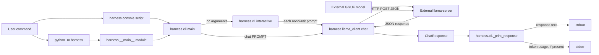

# Implemented code map

This guide describes the code that exists today. The Python package currently
supports a one-request chat command, a stateless interactive prompt loop, and the
initial agent run-state and action parsing contracts; the autonomous agent loop
and its planned tools are future work. Interactive prompts
are independent requests with no conversation history. This page is maintained
alongside code changes, not generated or refreshed by an automatic watcher.

## Request flow



`llama-server` and the GGUF model are external processes/files, not Python
modules in this repository. In interactive mode Python sends each nonblank
prompt as its own non-streaming chat request, without carrying conversation
history between requests. The one-shot `chat PROMPT` command remains available.
The action parser is not connected to this request flow. There is no repository
inspection, tool dispatch, multi-step agent loop, or autonomous editing.

## Package files

| File | Responsibility |
| --- | --- |
| [`src/harness/__init__.py`](../src/harness/__init__.py) | Package docstring; no runtime behavior. |
| [`src/harness/__main__.py`](../src/harness/__main__.py) | Calls `harness.cli.main()` so `python -m harness` works. |
| [`src/harness/cli.py`](../src/harness/cli.py) | Starts the interactive loop with no arguments; parses and validates one-shot `chat` options; shares response and usage formatting; handles interactive termination and retryable request errors. |
| [`src/harness/llama_client.py`](../src/harness/llama_client.py) | Builds the llama.cpp chat request, sends it with `urllib`, validates/parses the response, and normalizes available usage counts. |
| [`src/harness/agent/__init__.py`](../src/harness/agent/__init__.py) | Exports the agent run state and normalized action protocol types and parser. |
| [`src/harness/agent/state.py`](../src/harness/agent/state.py) | Defines run lifecycle statuses, mutable `AgentRun` state and counters, and permitted state transitions. |
| [`src/harness/agent/protocol.py`](../src/harness/agent/protocol.py) | Defines frozen tool, completion, and invalid action dataclasses and strictly parses a single JSON action envelope. |

## Agent runtime contracts

`RunStatus` is a `str` enum with values `pending`, `running`,
`waiting_approval`, `completed`, `failed`, `limit_reached`, and `cancelled`.
`AgentRun(task: str, workspace: Path, status: RunStatus = PENDING, steps: int =
0, model_calls: int = 0, final_response: str | None = None)` is mutable.
`transition_to(status: RunStatus) -> None` permits `PENDING → RUNNING` and
`RUNNING → COMPLETED`, `FAILED`, `LIMIT_REACHED`, or `CANCELLED`. Other
transitions, including all transitions involving `WAITING_APPROVAL`, raise
`ValueError`; terminal states are immutable. The future loop owns counter
updates: `model_calls` counts inference attempts, while `steps` counts
processed actions, including invalid actions. The present package defines the
fields but does not increment them.

`ToolAction(name: str, arguments: dict[str, object])`,
`CompleteAction(summary: str)`, and `InvalidAction(reason: str)` are frozen
dataclasses with fixed `kind` values `tool`, `complete`, and `invalid`.
`Action` is their union. `parse_action(text: str) -> Action` accepts exact
`tool` and `complete` object envelopes, rejects malformed or ambiguous JSON as
`InvalidAction`, and leaves tool-name and argument semantics to future dispatch
code. Parsing a completion proposal does not change an `AgentRun`.

The parser's private `_unique_object(pairs: list[tuple[str, object]]) ->
dict[str, object]` hook rejects duplicate keys at every object depth, and
`_reject_constant(value: str) -> None` rejects non-standard JSON numeric
constants. These contracts are implemented but are not yet called by the CLI
or an agent loop.

The `harness` console script registered in `pyproject.toml` points to
`harness.cli:main`, the same entry point used by `python -m harness`.

## API reference

### `main(argv: list[str] | None = None) -> None`

Defined in [`cli.py`](../src/harness/cli.py). When `argv` is `None`, reads
arguments from `sys.argv[1:]`; an explicit list allows direct calls in tests.
With an empty argument list it calls `interactive()`. Otherwise accepts:

```text
chat PROMPT [--base-url URL] [--model NAME] [--timeout SECONDS] [--max-tokens N]
```

Defaults: `http://127.0.0.1:9931`,
`Qwen2.5-Coder-7B-Instruct-Q4_K_M.gguf`, 120 seconds, and 256 tokens. A blank
prompt, non-finite or non-positive timeout, or non-positive token limit is an
argparse error (exit 2). A client or input validation error is printed to
stderr and exits 1. Successful response text goes to stdout; token counts go to
stderr only when at least one count is available.

### `interactive() -> None`

Defined in [`cli.py`](../src/harness/cli.py). Prints a short banner and reads
prompts using `You > `. Blank input is ignored; `/exit`, EOF, and Ctrl+C end the
loop cleanly. Each nonblank prompt is passed to `chat()` with its defaults, so
there is no conversation history or per-session model state. A client or
validation error is printed to stderr and the loop continues, allowing a retry.

### `_print_response(response: ChatResponse) -> None`

Internal shared formatter in [`cli.py`](../src/harness/cli.py). Prints response
text to stdout and any available token counts to stderr for both interactive
and one-shot requests.

### `chat(prompt: str, *, base_url: str = 'http://127.0.0.1:9931', model: str = 'Qwen2.5-Coder-7B-Instruct-Q4_K_M.gguf', timeout: float = 120, max_tokens: int = 256) -> ChatResponse`

Defined in [`llama_client.py`](../src/harness/llama_client.py). Requires a
non-blank prompt, finite positive timeout, and positive integer `max_tokens`.
It POSTs JSON to `{base_url}/v1/chat/completions` with `model`, one user
`messages` entry, `max_tokens`, and `stream: false`. It expects a string at
`choices[0].message.content`; usage counts are optional. It raises
`ValueError` for invalid inputs and `LlamaClientError` for HTTP/network/timeout
failures or malformed response JSON/content.

### `ChatResponse`

Frozen dataclass returned by `chat`:

- `text: str` — first response choice's message content.
- `prompt_tokens: int | None` — prompt count, if supplied as an integer.
- `completion_tokens: int | None` — completion count, if supplied as an integer.
- `total_tokens: int | None` — total count, if supplied as an integer.

Missing, non-integer, or otherwise unusable usage values become `None`.

### `LlamaClientError`

Client exception for an HTTP status failure, connection/timeout failure, or
malformed response. The CLI displays its message without a traceback.

### `_usage_count(usage: object, key: str) -> int | None`

Internal helper. Returns an integer usage field from a dictionary; absent or
non-integer values (including booleans) return `None`.

## Following one command

1. `harness` or `python -m harness` enters through the console script or
   [`__main__.py`](../src/harness/__main__.py), then invokes `main()`.
2. With no arguments, `main()` starts `interactive()`, which reads a prompt and
   calls `chat(prompt)` once. Each cycle carries only the current prompt.
3. With explicit `chat PROMPT` arguments, `main()` validates options and calls
   `chat()` once with the requested configuration.
4. `chat()` posts one JSON request, parses the first choice and optional token
   counts, and returns `ChatResponse`; `_print_response()` prints the result.

The CLI tests in [`tests/test_cli.py`](../tests/test_cli.py) cover the module
entry point, independent interactive requests, blank input, termination,
retryable errors, option forwarding, output streams, and CLI errors. The client
tests in [`tests/test_llama_client.py`](../tests/test_llama_client.py) cover the
HTTP payload, response/usage parsing, input limits, and
HTTP/network/timeout/malformed response failures. These mocked tests do not
start a server; the separate local smoke result is recorded in
[`local-model.md`](local-model.md).
