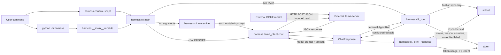
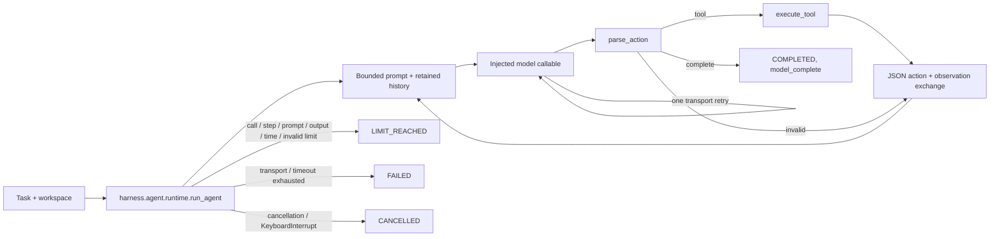
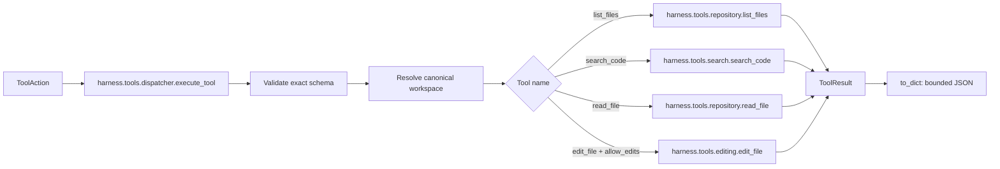

# Implemented code map

This guide describes the code that exists today. The Python package currently
supports a one-request chat command, a stateless interactive prompt loop, a
read-only-by-default repository task command, agent run-state and action
parsing, bounded read tools, policy-gated edits and fixed pytest execution,
and a bounded agent loop with independent budgets, cooperative cancellation,
approval wait, and transport retry. Interactive prompts
are independent requests with no conversation history. This page is maintained
alongside code changes, not generated or refreshed by an automatic watcher.

## Request flow



`llama-server` and the GGUF model are external processes/files, not Python
modules in this repository. In interactive mode Python sends each nonblank
prompt as its own non-streaming chat request, without carrying conversation
history between requests. The one-shot `chat PROMPT` command remains available.
The action parser and repository dispatcher are used by `run` via `run_agent()`.
The default command stays read-only. `--coding` opts into separate edit/test
policies and fixed configured pytest targets; `--auto-approve` explicitly sets
both to AUTO. Direct Python callers may still pass `allow_edits=True` only when
no `ToolPolicy` is supplied. A model completion is reported as unverified.

## Agent runtime flow



## Tool API flow



## Package files

| File | Responsibility |
| --- | --- |
| [`src/harness/__init__.py`](../src/harness/__init__.py) | Package docstring; no runtime behavior. |
| [`src/harness/__main__.py`](../src/harness/__main__.py) | Calls `harness.cli.main()` so `python -m harness` works. |
| [`src/harness/cli.py`](../src/harness/cli.py) | Starts the interactive loop with no arguments; parses `chat`, default read-only `run`, and opt-in `run --coding` options; binds profile-specific system prompts and copied schemas; asks for approval only on interactive stdin/stderr or enables AUTO with explicit `--auto-approve`; manages default SQLite trace persistence (`--db-path`) or `--no-db`; reports run ID, SQLite path, benchmark outcome, token usage, changed paths, test outcomes, verification quality, candidate diff, and unresolved issues to stderr. |
| [`src/harness/llama_client.py`](../src/harness/llama_client.py) | Builds llama.cpp chat (`/v1/chat/completions`) and `/tokenize` requests, optionally prepends a system message and forwards a JSON response schema, sends them with `urllib`, reads at most 1 MiB plus a sentinel, classifies transport/timeouts and oversized bodies, validates/parses JSON, and normalizes available usage counts. |
| [`src/harness/agent/__init__.py`](../src/harness/agent/__init__.py) | Exports the agent run state, normalized action protocol types and parser, verification quality, no-progress tracker, run events (`RunEvent`, `RunEventType`, `BenchmarkOutcome`), and `run_agent`. |
| [`src/harness/agent/events.py`](../src/harness/agent/events.py) | Defines the structured `RunEventType` enum (including `CONTEXT_EDIT` and `CONTEXT_PRUNED`), stable `BenchmarkOutcome` taxonomy, and frozen `RunEvent` dataclass with sequence, timestamp, duration, and serialization helpers. |
| [`src/harness/agent/state.py`](../src/harness/agent/state.py) | Defines run lifecycle statuses including approval wait, mutable `AgentRun` with unique UUID4 `run_id`, `events`, `benchmark_outcome`, token counters (`total_prompt_tokens`, `total_completion_tokens`, `total_tokens`), wall-clock timestamps and duration, counters and stop reason, confirmed `changed_paths`, latest bounded `last_tool_result` and `last_test_result`, `last_write_state`, verification quality, candidate diff, test invocations, unresolved issues, edit/test step indices, and permitted state transitions. |
| [`src/harness/agent/verification.py`](../src/harness/agent/verification.py) | Defines `VerificationQuality` (`verified`, `partially_verified`, `unverified`), `NoProgressTracker` for repeated identical tool actions and rejected completions, and `evaluate_verification` to enforce post-edit passing test requirements. |
| [`src/harness/agent/protocol.py`](../src/harness/agent/protocol.py) | Defines frozen tool, `context_edit` (normalized from `update_context`), completion, and invalid action dataclasses and strictly parses a single JSON action envelope, normalizing deeply nested JSON as invalid. |
| [`src/harness/agent/runtime.py`](../src/harness/agent/runtime.py) | Defines read-only and coding system prompts, read-only schema and per-run `action_schema(policy, include_context_edit=...)`; pins profile-specific tool instructions; delegates prompt construction to a swappable `ContextStrategy` (default `BoundedHistoryStrategy`); validates and executes `context_edit` (`update_context`) and bounded `read_memory` actions against `WorkingMemoryStore` or an in-memory buffer; validates model/runtime limits and `on_event` callback, tracks approval wait transitions, delegates policy decisions to the dispatcher, checks post-edit passing tests and no-progress repetitions, records candidate diffs, retries one typed transport failure, streams structured run events, notifies optional `RunRecorder` on lifecycle transitions, accumulates token metrics, and runs within independent budgets. |
| [`src/harness/context/__init__.py`](../src/harness/context/__init__.py) | Exports the context-strategy, token-budgeting, and working-memory subsystem: `ContextInput`, `ContextStrategy`, `BoundedHistoryStrategy`, `EditableContextStrategy`, `TokenBudget`, `TokenCounter`, `LlamaTokenCounter`, `PromptPruningReport`, `estimate_tokens`, `resolve_token_counter`, `WorkingMemoryStore`, `MemoryStorageError`, `DEFAULT_READ_MEMORY_MAX_BYTES`, `resolve_context_strategy`, and `validate_scope_id`. |
| [`src/harness/context/budgeting.py`](../src/harness/context/budgeting.py) | Implements `TokenBudget` (`context_window` minus output reserve, overhead, and safety margin), `TokenCounter` / `LlamaTokenCounter` (with deterministic `estimate_tokens()` fallback), `PromptPruningReport`, `within_budget()`, and `trim_notes_deterministically()`. |
| [`src/harness/context/memory.py`](../src/harness/context/memory.py) | Implements task- and session-scoped Markdown working memory under `.harness/runs/<scope-id>/` (`working.md`, `task.md`, lazy `findings/*.md`, and immutable `metadata.json`) with atomic writes, byte caps, bounded `read_memory_bounded()` retrieval, and path-confinement checks. |
| [`src/harness/context/strategy.py`](../src/harness/context/strategy.py) | Defines the `ContextInput` dataclass (instructions, directive, task, history, byte/token limits, token counter, run state, recent events, repository excerpts, optional task notes) and `ContextStrategy` protocol. |
| [`src/harness/context/strategies.py`](../src/harness/context/strategies.py) | Implements `BoundedHistoryStrategy` (exact Phase 4 baseline), opt-in `EditableContextStrategy` (supporting bounded notes, excerpts, and deterministic overflow pruning via `build_prompt_with_report()`), and `resolve_context_strategy()`. |
| [`src/harness/retrieval/__init__.py`](../src/harness/retrieval/__init__.py) | Exports the Phase 6 retrieval boundary, candidate filtering, Python Tree-sitter symbol parser, and repository symbol map: `RetrievalBackend`, `LexicalRetrievalBackend`, `CodeAwareRetrievalBackend`, `NormalizedRetrievalMatch`, `PythonSymbol`, `PythonParseResult`, `RepoSymbolIndex`, `RepoMapResult`, `CachedFileIndex`, `parse_python_file`, `extract_python_symbols_from_bytes`, `resolve_retrieval_backend`, and `classify_candidate`. |
| [`src/harness/retrieval/backend.py`](../src/harness/retrieval/backend.py) | Defines `RetrievalBackend`, `NormalizedRetrievalMatch`, `LexicalRetrievalBackend` (Phase 3-5 baseline), `CodeAwareRetrievalBackend` (filtered discovery, normalized matches, and per-run `RepoSymbolIndex` cache/invalidation behind existing tools), and `resolve_retrieval_backend()`. |
| [`src/harness/retrieval/filtering.py`](../src/harness/retrieval/filtering.py) | Classifies repository candidates (`classify_candidate()`) with explicit skip reasons (`excluded_directory`, `hidden_or_ignored`, `file_too_large`, `binary_or_unsupported`, `generated_or_minified`) and optional approved overrides. |
| [`src/harness/retrieval/python_symbols.py`](../src/harness/retrieval/python_symbols.py) | Parses Python files with Tree-sitter (`parse_python_file()`, `extract_python_symbols_from_bytes()`) to extract functions, async functions, classes, methods, imports, parent/nesting names, quoted headers, 1-based source ranges, SHA-256 fingerprints, and graceful fallback signals (`syntax_errors`, `unsupported_language`, `file_too_large`, `binary_or_encoding_error`). |
| [`src/harness/retrieval/repo_map.py`](../src/harness/retrieval/repo_map.py) | Implements `RepoSymbolIndex`, `CachedFileIndex`, and `RepoMapResult` for bounded compact Python repository maps with path/stat/SHA-256 caching, invalidation on edit/rename/delete, and workspace confinement. |
| [`src/harness/storage/__init__.py`](../src/harness/storage/__init__.py) | Exports the persistence subsystem: `RunRecorder`, `SqliteRunRecorder`, `LoggingPolicy`, `RunArtifacts`, `StorageError`, `load_run_record`, `write_run_artifacts`, and `sanitize_manifest`. |
| [`src/harness/storage/recorder.py`](../src/harness/storage/recorder.py) | Defines `LoggingPolicy` (`DEGRADED`, `FAIL`), `StorageError`, `RunArtifacts`, and the `RunRecorder` protocol with `on_run_started()`, `on_event()`, and `on_run_finished()`. |
| [`src/harness/storage/database.py`](../src/harness/storage/database.py) | Implements `SqliteRunRecorder` for SQLite execution traces and event persistence; creates `runs` and `events` tables with sequence indices, manages connection timeouts, handles write errors under the configured logging policy, and provides `load_run_record()` for run reconstruction. |
| [`src/harness/storage/artifacts.py`](../src/harness/storage/artifacts.py) | Writes run-scoped disk artifacts (`manifest.json`, `solution.patch`, and bounded `verification.log`) under `.runs/artifacts/<run_id>/` and redacts sensitive credential keys. |
| [`src/harness/evaluation/__init__.py`](../src/harness/evaluation/__init__.py) | Exports the fixture evaluation subsystem, configuration pinning (`ExperimentConfig`, `ModelSpec`), macOS memory observation (`MemorySnapshot`, `sample_macos_memory`), and suite/comparison runner (`evaluate_suite`, `compare_strategies`, `load_suite_dir`, `SuiteSummary`, `StrategyComparisonReport`). |
| [`src/harness/evaluation/config.py`](../src/harness/evaluation/config.py) | Defines `ModelSpec` and `ExperimentConfig`, streams GGUF SHA-256 digests (`compute_file_sha256`), and captures git commit and macOS host metadata without estimating missing values. |
| [`src/harness/evaluation/manifest.py`](../src/harness/evaluation/manifest.py) | Defines `OracleTier`, `ManifestError`, and `TaskManifest` with JSON validation and `agent_prompt()` to keep `reference_patch` and private metadata out of agent prompts. |
| [`src/harness/evaluation/resources.py`](../src/harness/evaluation/resources.py) | Defines `MemorySnapshot`, pure parsers for `sysctl vm.swapusage`, `memory_pressure -Q`, and `ps -o rss=`, and `sample_macos_memory()` with `None` for unavailable metrics. |
| [`src/harness/evaluation/workspace.py`](../src/harness/evaluation/workspace.py) | Creates fresh detached git checkouts at `base_commit`, runs optional setup commands, captures unified diffs of tracked/untracked edits, applies candidate patches to separate evaluator checkouts, and restores oracle paths. |
| [`src/harness/evaluation/runner.py`](../src/harness/evaluation/runner.py) | Runs `evaluate_task()` across isolated agent and evaluator checkouts (supporting `context_strategy`, isolated per-trial `memory_dir`, `token_budget`, `token_counter`, and `max_tool_output_bytes`), samples before/after memory snapshots, runs declared pytest oracle targets, maps outcomes and run metrics to `EvaluationResult`, and writes optional run artifacts with pinned `ExperimentConfig`. |
| [`src/harness/evaluation/suite.py`](../src/harness/evaluation/suite.py) | Loads sorted task manifests (`load_suite_dir`), runs `evaluate_suite()` sequentially with SQLite trace persistence, writes `suite_summary.json` and `suite_summary.md` via `SuiteSummary`, and runs head-to-head `compare_strategies()` producing `StrategyComparisonReport` (`strategy_comparison.md`). |
| [`src/harness/tools/__init__.py`](../src/harness/tools/__init__.py) | Exports `ToolResult` and `execute_tool`. |
| [`src/harness/tools/dispatcher.py`](../src/harness/tools/dispatcher.py) | Defines the bounded frozen result type and `execute_tool(...)`; validates exact schemas before workspace access, retains the legacy `allow_edits=True` path only without policy, and owns edit/test AUTO/ASK/DENY checks, approval metadata, target revalidation, and dispatch. |
| [`src/harness/tools/repository.py`](../src/harness/tools/repository.py) | Implements ripgrep-based bounded file discovery and bounded UTF-8 line-range reads with workspace containment checks; successful reads include the SHA-256 of complete file bytes for edit preconditions. |
| [`src/harness/tools/editing.py`](../src/harness/tools/editing.py) | Defines frozen `PreparedEdit`, separates `prepare_edit()` from `apply_prepared_edit()` so approved data is immutable and revalidated against the preimage, and retains `edit_file()` as the direct prepare/apply API; validates protected paths and reconciles writes into `unchanged`, `applied`, or `unknown`. |
| [`src/harness/tools/search.py`](../src/harness/tools/search.py) | Validates regular expressions with ripgrep, runs bounded JSON lexical search under one deadline, filters workspace-relative matches and filename globs, deduplicates path/line hits, and returns sorted bounded previews. |
| [`src/harness/tools/policy.py`](../src/harness/tools/policy.py) | Defines frozen `ToolPolicy` with edit/test `ToolMode` values and fixed pytest targets/timeout, plus frozen `ApprovalRequest` metadata for prepared edits and exact pytest invocations. |
| [`src/harness/tools/testing.py`](../src/harness/tools/testing.py) | Validates configured targets before inference; runs only the fixed pytest argv, captures bounded UTF-8-safe output, kills and reaps POSIX process groups on timeout/cancellation/output/error, and preserves bounded result metadata. |

## Agent runtime contracts

`RunStatus` is a `str` enum with values `pending`, `running`,
`waiting_approval`, `completed`, `failed`, `limit_reached`, and `cancelled`.
`AgentRun(task: str, workspace: Path, status: RunStatus = PENDING, steps: int =
0, model_calls: int = 0, final_response: str | None = None, stop_reason: str |
None = None, changed_paths: list[str] = [], last_tool_result: dict | None =
None, last_write_state: str | None = None, last_test_result: dict | None =
None, run_id: str = ..., events: list[RunEvent] = [], benchmark_outcome: BenchmarkOutcome | None = None,
total_prompt_tokens: int | None = None, total_completion_tokens: int | None = None,
total_tokens: int | None = None, start_time: float = ..., end_time: float | None = None,
duration_seconds: float | None = None)` is mutable; `changed_paths` and `events` use per-instance list factories.
`run_id` defaults to a fresh UUID4 string.
`transition_to(status: RunStatus) -> None` permits `PENDING → RUNNING`,
`RUNNING → WAITING_APPROVAL` or a terminal state, and
`WAITING_APPROVAL → RUNNING`, `FAILED`, `LIMIT_REACHED`, or `CANCELLED`.
Other transitions raise `ValueError`; terminal states are immutable. `model_calls` counts attempted
inference calls, while `steps` counts processed responses, including invalid
actions. Stop reasons include `model_complete`, `model_call_limit`,
`step_limit`, `invalid_action_limit`, `prompt_budget`, `model_output_limit`,
`run_timeout`, `model_timeout`, `model_error`, and `cancelled`.

`run_agent(task: str, workspace: Path, *, model: Callable[..., ChatResponse] =
chat, max_model_calls: int = 20, max_steps: int = 20,
max_consecutive_invalid_actions: int = 3, request_timeout: float = 120,
run_timeout: float = 300, max_prompt_bytes: int = 24576,
max_model_response_bytes: int = 65536,
cancelled: Callable[[], bool] | None = None,
policy: ToolPolicy | None = None,
approve: Callable[[ApprovalRequest], bool] | None = None,
on_event: Callable[[RunEvent], None] | None = None) -> AgentRun` requires a nonblank
task, an existing canonical workspace directory, a model accepting
`model(prompt, *, timeout=seconds)`, positive integer budgets and finite
positive timeouts (booleans rejected), and an optional cancellation callback.
Calls count attempts and retries; steps count processed response text, not
transport failures or oversized HTTP bodies. Cancellation precedes the
monotonic deadline, which precedes completion. Last-call and last-step
completions are accepted. One typed transport/timeout failure retries the same
prompt within the remaining call/time budget. Oversized response text counts
as a step; an oversized HTTP body stops without a step. Invalid tool/protocol
actions advance the invalid streak; ordinary tool errors are observations and
reset it. Only completion sets `final_response`.

`READ_ONLY_ACTION_SCHEMA` in `runtime.py` permits exactly four object forms:
`list_files` with optional `directory` / `pattern` strings, `search_code` with
required `query` and optional `glob` / `max_results`, `read_file` with
required `path` and optional positive integer line bounds, or `complete` with a
nonempty `summary`. Tool argument objects and action objects reject extra
fields. The schema requires strings to have at least one character; the
dispatcher also rejects whitespace-only paths and patterns and enforces path
containment. It does not put a maximum on line numbers; the dispatcher enforces
`end_line >= start_line` and a range of at most 200 lines. The `run` CLI binds
this schema to its llama client callable; direct `run_agent()` callers still
only need to provide callables accepting `model(prompt, *, timeout=...)`.
`READ_ONLY_SYSTEM_PROMPT` is passed as a system message by the CLI run path.
The CLI subtracts its UTF-8 byte length from `max_prompt_bytes`, keeping the
system and user message contents together within the 24 KiB default.

Prompt assembly pins the original task and safety/protocol instructions,
including exact `list_files`, `search_code`, `read_file`, and `complete` examples, the allowed
`kind` values, and guidance to use listing for path-only questions and read
requested contents before answering; it then includes chronological JSON
action/observation exchanges and a next-action directive. To stay within the
UTF-8 byte limit, it removes oldest whole
exchanges from history while preserving the next-action directive at the end;
the directive's bytes count toward the budget. If the pinned content or newest
exchange does not fit, the run stops with `LIMIT_REACHED` and `prompt_budget`
before inference. The limit measures bytes, not model tokens. An invalid
response gets the valid `read_file` request schema, a reminder that the tool
name belongs in `name`, and a UTF-8-safe excerpt of the rejected response.
`complete` triggers `evaluate_verification(run, policy)`. In read-only runs or coding
runs without file changes, completion stores its summary as `final_response` and
ends `COMPLETED` with `VerificationQuality.UNVERIFIED`. When files have been modified,
completion requires a recorded passing `run_tests` call strictly after the latest edit;
otherwise the proposal is rejected with corrective feedback. Repeated unverified
proposals or identical valid tool calls trigger `NoProgressTracker` and terminate with
`no_progress`. A verified run ends `COMPLETED` with `VerificationQuality.VERIFIED`.
This status alone remains a runtime verification result, not independent benchmark resolution.

Runtime helpers in [`runtime.py`](../src/harness/agent/runtime.py):
`action_schema(policy: ToolPolicy | None = None) -> dict[str, object]` returns
a deep-copied schema with only enabled coding actions; `_execute_runtime_tool(...)`
delegates authorization/execution to the dispatcher, then records `last_tool_result`
and confirmed paths before stop boundaries; `_request_approval(run, approve,
request, cancelled, deadline) -> bool` performs the `WAITING_APPROVAL` transition,
fails closed, and checks cancellation/deadline after approval.
`_validate_invocation(task, workspace, model, max_model_calls, max_steps,
max_consecutive_invalid_actions, request_timeout, run_timeout,
max_prompt_bytes, max_model_response_bytes, cancelled) -> Path` validates
arguments, model timeout compatibility, and returns the canonical workspace
before inference; `_request_model(run, model, prompt, request_timeout, deadline,
max_model_calls, cancelled)` enforces the call budget and one transport retry
while forwarding the smaller request/remaining-run timeout;
`_boundary_stop(run, cancelled, deadline)` checks cancellation before the
monotonic deadline; `_stop(run: AgentRun, status: RunStatus, reason: str) ->
None` records the reason and transitions the run; `_exchange(action: object,
observation: object) -> str` serializes one JSON history entry;
`_build_prompt(task: str, history: list[str], byte_limit: int, *, policy: ToolPolicy | None = None) -> str | None`
assembles the pinned profile prompt and matching next-action directive, trimming
oldest complete history entries in place until they fit the byte limit, or
returns `None` when the pinned prompt, directive, and newest entry cannot fit;
`_coding_prompt(policy: ToolPolicy) -> tuple[str, str]` lists only enabled coding tools and exact configured pytest targets;
`_utf8_excerpt(value: str, byte_limit: int) -> str` returns a UTF-8-safe
excerpt bounded by bytes.

`ToolAction(name: str, arguments: dict[str, object])`,
`CompleteAction(summary: str)`, and `InvalidAction(reason: str)` are frozen
dataclasses with fixed `kind` values `tool`, `complete`, and `invalid`.
`Action` is their union. `parse_action(text: str) -> Action` accepts exact
`tool` and `complete` object envelopes, rejects malformed or ambiguous JSON as
`InvalidAction`, and leaves tool argument semantics to dispatch. Parsing a
completion proposal does not change an `AgentRun`.

The parser's private `_unique_object(pairs: list[tuple[str, object]]) ->
dict[str, object]` hook rejects duplicate keys at every object depth, and
`_reject_constant(value: str) -> None` rejects non-standard JSON numeric
constants. The CLI does not use these APIs; `run_agent()` calls
`parse_action()` for every model response.

### Repository tool APIs

`execute_tool(action: ToolAction, workspace: Path, *, allow_edits: bool =
False, policy: ToolPolicy | None = None, approve: Callable[[ApprovalRequest],
bool] | None = None, deadline: float | None = None, cancelled:
Callable[[], bool] | None = None) -> ToolResult` dispatches read tools by
default. The legacy `allow_edits=True` is supported only when policy is absent.
With a policy, dispatcher owns edit/test mode checks, approval, exact operation
preparation, and execution. It validates exact schemas before resolving the
workspace and returns structured failures. Workspace path checks do not
protect against hostile concurrent filesystem changes.

`ToolMode` contains `AUTO`, `ASK`, and `DENY`. Frozen
`ToolPolicy(edit_file: ToolMode = ASK, run_tests: ToolMode = ASK,
test_targets: tuple[str, ...] = (".",), test_timeout: float = 60.0)` keeps
read-only tools automatic. `__post_init__()` validates modes, target tuple,
and finite positive timeout. Frozen `ApprovalRequest` records canonical root
and exact edit metadata or pytest command metadata. `normalize_target(target:
str) -> str` removes harmless relative path spelling differences. `validate_test_policy(root: Path, policy: ToolPolicy) -> tuple[str, ...]`
validates existing, contained, nonsymlink targets before model inference.

`list_files(root: Path, arguments: dict[str, object]) -> ToolResult` accepts
optional `directory` (default `.`) and nonblank string `pattern`. It calls
ripgrep without a shell, strips `RIPGREP_CONFIG_PATH`, disables global Git
ignores, and retains repository ignore handling in Git and non-Git workspaces.
The pattern filters discovered workspace-relative paths using Python
`Path.match` glob syntax, not regular expressions: `*.py` matches Python files;
literal names such as `settings.py` and `greeting.py` can be requested in
separate calls. `settings.py|greeting.py` is not alternation. An empty filtered
result does not establish that a path is absent; retry with a simpler pattern
or omit the pattern. Path-only questions can be answered from a successful
listing, while content questions require `read_file`. Patterns cannot override
ignore rules. Hidden paths and generated directories
(`node_modules`, `.venv`, `__pycache__`, `dist`, `build`) are always filtered.
Results are sorted and limited by 200 paths, 64 KiB of ripgrep output, and a
five-second timeout. No matches is a successful empty result; filtered empty
results include a message explaining literal `|` and suggesting simpler or
unfiltered searches. `rg` must be
installed separately.

`search_code(root: Path, arguments: dict[str, object]) -> ToolResult` requires
a nonblank, single-line regex query up to 4096 UTF-8 bytes, with optional
positive `Path.match` filename glob and integer result limit 1–200 (default
50). It preflights regex syntax then invokes ripgrep with JSON output, fixed
hidden/generated exclusions, workspace ignore rules, and a shared five-second
deadline. It accepts UTF-8 matching lines from files at most 1 MiB, filters
glob and containment after discovery, deduplicates path/line matches, and sorts
the collected results. Previews are limited to 512 UTF-8 bytes; stdout to
64 KiB, stderr to 4 KiB, and the serialized result to 32 KiB. Match-count or
byte-limit stops and preview clipping set `truncated`; unsupported UTF-8
previews are skipped. A successful empty result means no visible bounded match
was found. `rg` must be installed separately.

Search helpers in `harness.tools.search`:

- `_collect_match(raw: bytes, root: Path, glob: object, seen: set[tuple[str,
  int]], matches: list[dict[str, object]]) -> bool` validates a complete JSON
  event, appends an accepted unique line, and reports preview clipping. It skips
  unsupported UTF-8 previews and rejects malformed events as controlled errors.
- `_run(command: list[str], root: Path, env: dict[str, str], deadline: float,
  *, stdout_limit: int, stderr_limit: int, stdin: int = subprocess.DEVNULL,
  on_stdout_line: Callable[[bytes], bool] | None = None) -> tuple[bytes, bytes,
  bool, int]` captures bounded stdout/stderr and delivers complete stdout lines
  to a callback. A true callback result stops collection. It reaps the child on
  every exit and drains bounded stderr after a limit stop so execution errors
  remain visible. `_OutputCap` is its private limit-stop signal.

`read_file(root: Path, arguments: dict[str, object]) -> ToolResult` requires
`path` and accepts optional positive integer `start_line` and `end_line` values
(inclusive). It reads at most 1 MiB plus one sentinel byte, rejects non-regular
files, NUL bytes, and invalid UTF-8, and returns at most 200 numbered lines and
16 KiB of content. Results include relative path, byte size, SHA-256 of the
complete original bytes, total lines, and actual returned line bounds; empty
results use null bounds. `truncated` reports omitted ranges or content.

`edit_file(root: Path, arguments: dict[str, object]) -> ToolResult` requires
exactly `path`, `expected_sha256` (64 hex characters), `old_text`, and
`new_text`. It edits an existing UTF-8 regular file up to 1 MiB after matching
the current content hash and exactly one occurrence of `old_text`; empty old
text is valid only for an empty file. It rejects binary/invalid UTF-8 files,
protected path components, symlinks, hard links, and nonwritable files or
parents. It preserves file mode and all bytes outside the match, stages and
fsyncs a temporary file beside the target, then rechecks target identity and
content before `os.replace`. A no-op returns `write_state="unchanged"` without
writing. Results contain the target path, confirmed changed paths, write state
(`unchanged`, `applied`, or `unknown`), and a unified diff with three context
lines and no-final-newline markers; the diff is capped at 16 KiB and the
ASCII-escaped JSON result at 32 KiB. Replacement exceptions are reconciled
against actual target bytes. Concurrent mutation after the final check and
process termination during replacement cannot be rolled back or reported.
This direct dispatcher API does not enable model-requested edits.

`PreparedEdit` is frozen and carries the root, relative target, expected hash,
exact replacement text, captured preimage/identity, mode, and diff.
`prepare_edit(root: Path, arguments: dict[str, object]) -> PreparedEdit | ToolResult`
does not write. `apply_prepared_edit(prepared: PreparedEdit) -> ToolResult`
revalidates preimage and identity before applying that exact operation.
`edit_file()` remains the one-call legacy wrapper around preparation/apply.

`run_tests(root: Path, target: str, timeout: float, *, deadline: float,
cancelled: Callable[[], bool] | None = None) -> ToolResult` invokes only the
fixed pytest argv with a configured exact target. `MAX_STREAM_BYTES` is 16 KiB
per stream. `_test_result(...)` preserves command/outcome metadata while
fitting output to the 32 KiB result budget; `_kill_group(process)` kills and
reaps the POSIX process group; `_drain_and_reap(...)` closes readers and
ensures the process is reaped.

Helpers in `harness.tools.editing`:

- `validate_edit_arguments(arguments: dict[str, object]) -> None` checks hash,
  UTF-8 paths/text, fragment sizes, and protected components before workspace
  access. `_reject_links(root: Path, target: Path) -> None` walks components to
  reject symlinks, including the final precommit check.
- `_same_identity(before: os.stat_result, after: os.stat_result) -> bool`
  compares device, inode, mode, and link count. `_create_temp(target: Path,
  contents: bytes, mode: int) -> Path` creates a uniquely named sibling with a
  fixed-length prefix, preserves mode, flushes/fsyncs, and cleans up failures.
- `_read_target_bounded(target: Path) -> bytes` rechecks symlink components and
  regular-file size before reading at most the file limit plus one byte.
  `_reconcile(relative: str, original: bytes, replacement: bytes, target: Path,
  error: BaseException, *, mutation_attempted: bool) -> ToolResult` distinguishes
  unchanged, confirmed replacement, and unknown post-error states.
- `_unified_diff(path: str, before: str, after: str) -> str` builds three-line
  context and missing-final-newline markers. `_audit_data(relative: str,
  state: str, diff: str, confirmed: bool) -> tuple[dict[str, object], bool]`
  reserves error-envelope space and bounds the diff without discarding audit
  metadata. `_edit_result(relative: str, state: str, diff: str, confirmed:
  bool) -> ToolResult` and `_error_result(relative: str, error: BaseException,
  state: str | None = None, diff: str = "", confirmed: bool = False) ->
  ToolResult` construct the corresponding bounded results.

`ToolResult(tool: str, ok: bool, data: dict[str, object], truncated: bool =
False, error_code: str | None = None, message: str | None = None)` is a frozen
dataclass. Its `__post_init__()` bounds result metadata and payload to 32 KiB,
trimming search matches while preserving the query;
`to_dict() -> dict[str, object]` returns the JSON-ready form. `_json_size(value:
object) -> int` measures the ASCII-escaped JSON size so the cap also holds for
Unicode content.

Dispatcher internals: `_validate_schema(tool: str, arguments: dict[str,
object]) -> None` owns exact field/type/range validation; `_validate_relative(path:
str) -> None` rejects absolute, NUL, and parent-traversal paths;
`_line_number(value: object, name: str) -> int` rejects booleans and nonpositive
integers; `_workspace(workspace: Path) -> Path` resolves the existing canonical
directory; `_error(tool: str, code: str, message: str) -> ToolResult` builds a
controlled failure.

Repository helpers: `_run_bounded(command: list[str], root: Path, env: dict[str,
str], pattern: str | None) -> tuple[bytes, bool, int]` streams ripgrep output
with byte, path-count, and time limits, killing and reaping the process when a
limit is reached. `_accept_path(raw: bytes, root: Path, pattern: str | None) ->
str | None` enforces containment, exclusions, and the positive path filter,
returning a normalized workspace-relative path when accepted;
`_resolve(root: Path, path: str) -> Path` resolves a path inside the workspace;
`_limit_utf8(value: str, limit: int) -> tuple[str, bool]` cuts content without
returning invalid UTF-8.

The `harness` console script registered in `pyproject.toml` points to
`harness.cli:main`, the same entry point used by `python -m harness`.

## API reference

### `main(argv: list[str] | None = None) -> None`

Defined in [`cli.py`](../src/harness/cli.py). When `argv` is `None`, reads
arguments from `sys.argv[1:]`; an explicit list allows direct calls in tests.
With an empty argument list it calls `interactive()`. Otherwise accepts:

```text
chat PROMPT [--base-url URL] [--model NAME] [--timeout SECONDS] [--max-tokens N]
run TASK [--repo PATH] [--base-url URL] [--model NAME] [--timeout SECONDS]
    [--max-tokens N] [--run-timeout SECONDS] [--max-model-calls N] [--max-steps N]
    [--coding] [--auto-approve] [--test-target PATH]... [--test-timeout SECONDS]
```

Defaults: `http://127.0.0.1:9931`,
`Qwen2.5-Coder-7B-Instruct-Q4_K_M.gguf`, 120 seconds, and 256 tokens. A blank
prompt, non-finite or non-positive timeout, or non-positive token limit is an
argparse error (exit 2). A client or input validation error is printed to
stderr and exits 1. Successful response text goes to stdout; token counts go to
stderr only when at least one count is available.

`run TASK` defaults to the current directory, the same local server/model,
256 response tokens, a 120-second request timeout, a 300-second run deadline,
20 model calls, and 20 steps. `--timeout` is passed to the runtime as its
request timeout; the runtime also shortens it to the remaining run deadline.
`--coding` opts into separate ASK edit/test policies, `--auto-approve` requires
`--coding` and explicitly grants AUTO, repeated `--test-target` values replace
the default `.`, and `--test-timeout` defaults to 60 seconds. ASK prompts use
only interactive stdin/stderr and deny when that channel is unavailable.
Invalid tasks, repository paths, and limits are argparse errors (exit 2) before
inference. On completion the final answer alone is written to stdout. Stderr
reports status, stop reason, model-call and step counts, and labels completion
as unverified. Failed or limited runs exit 1; cancellation exits 130. Runtime
prompt/output budgets are bytes, not tokens. Cancellation is cooperative at
runtime boundaries and cannot forcibly stop an in-flight request.

Internal helper `_run(args: argparse.Namespace, parser: argparse.ArgumentParser)
-> None` validates coding-only CLI flags, builds the optional immutable policy,
binds the matching system prompt and per-run action schema with
`functools.partial`; it reduces `max_prompt_bytes` by
the system prompt's UTF-8 length so system plus user message contents remain
within 24 KiB; then it passes that callable and budgets to `run_agent()` and
maps the terminal run to output streams and exit code. `_STOP_DETAILS` maps
known runtime stop reasons to concise human-readable stderr text.

### `interactive() -> None`

Defined in [`cli.py`](../src/harness/cli.py). Prints a short banner and reads
prompts using `You > `. Blank input is ignored; `/exit`, EOF, and Ctrl+C end the
loop cleanly. Each nonblank prompt is passed to `chat()` with its defaults, so
there is no conversation history or per-session model state. A client or
validation error is printed to stderr and the loop continues, allowing a retry.

### `_print_response(response: ChatResponse) -> None`

Internal shared formatter in [`cli.py`](../src/harness/cli.py). Prints response
text to stdout and any available token counts to stderr for both interactive
and one-shot requests.

### `chat(prompt: str, *, base_url: str = 'http://127.0.0.1:9931', model: str = 'Qwen2.5-Coder-7B-Instruct-Q4_K_M.gguf', timeout: float = 120, max_tokens: int = 256, response_schema: dict[str, object] | None = None, system_prompt: str | None = None) -> ChatResponse`

Defined in [`llama_client.py`](../src/harness/llama_client.py). Requires a
non-blank prompt, finite positive timeout, positive integer `max_tokens`, and a
dictionary or `None` for `response_schema`, and a nonblank string or `None` for
`system_prompt`. It POSTs JSON to
`{base_url}/v1/chat/completions` with `model`, one user `messages` entry,
`max_tokens`, and `stream: false`. If provided, `response_schema` adds
`response_format: {"type":"json_object","schema":...}`; otherwise that field
is omitted. If provided, `system_prompt` is a system-role message before the
user message; otherwise the original single-user-message payload is preserved.
It expects a string at
`choices[0].message.content`; usage counts are optional. It raises
`ValueError` for invalid inputs and `LlamaClientError` for HTTP/network/timeout
failures or malformed response JSON/content.

### `ChatResponse`

Frozen dataclass returned by `chat`:

- `text: str` — first response choice's message content.
- `prompt_tokens: int | None` — prompt count, if supplied as an integer.
- `completion_tokens: int | None` — completion count, if supplied as an integer.
- `total_tokens: int | None` — total count, if supplied as an integer.

Missing, non-integer, or otherwise unusable usage values become `None`.

### `LlamaClientError`

Client exception for an HTTP status failure, connection/timeout failure, or
malformed response. The CLI displays its message without a traceback.

### `_usage_count(usage: object, key: str) -> int | None`

Internal helper. Returns an integer usage field from a dictionary; absent or
non-integer values (including booleans) return `None`.

## Following one command

1. `harness` or `python -m harness` enters through the console script or
   [`__main__.py`](../src/harness/__main__.py), then invokes `main()`.
2. With no arguments, `main()` starts `interactive()`, which reads a prompt and
   calls `chat(prompt)` once. Each cycle carries only the current prompt.
3. With explicit `chat PROMPT` arguments, `main()` validates options and calls
   `chat()` once with the requested configuration. For `run TASK`, it validates
   CLI limits, `_run()` configures the model callable, and `run_agent()` owns
   the read-only action loop; `_run()` prints its result and terminal counters.
4. `chat()` posts one JSON request, parses the first choice and optional token
   counts, and returns `ChatResponse`; `_print_response()` prints the result.

The CLI tests in [`tests/test_cli.py`](../tests/test_cli.py) cover the module
entry point, independent interactive requests, blank input, termination,
retryable errors, option forwarding, output streams, CLI errors, deterministic
multi-file `run` behavior, budgets and runtime failures. A local live smoke test
is opt-in with `HARNESS_LIVE_SMOKE=1`; it must pass before recording live-model
acceptance. The client
tests in [`tests/test_llama_client.py`](../tests/test_llama_client.py) cover the
HTTP payload, response/usage parsing, input limits, and
HTTP/network/timeout/malformed response failures. These mocked tests do not
start a server; the separate local smoke result is recorded in
[`local-model.md`](local-model.md).
