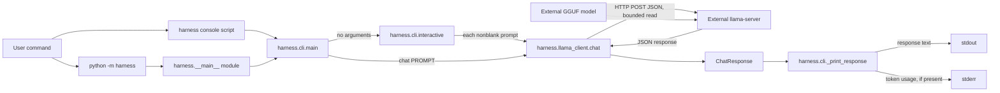
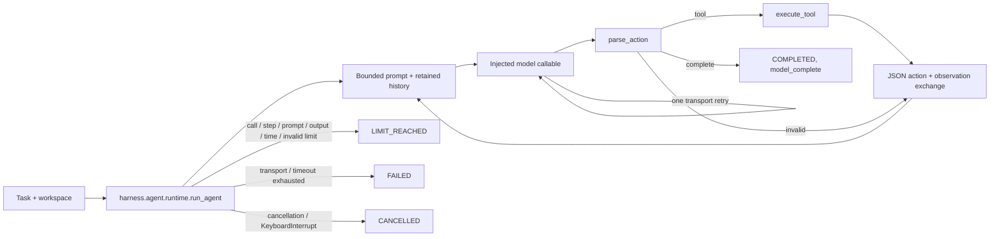
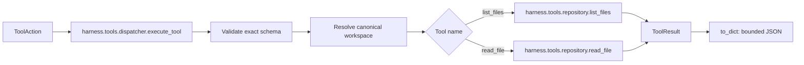

# Implemented code map

This guide describes the code that exists today. The Python package currently
supports a one-request chat command, a stateless interactive prompt loop, agent
run-state and action parsing, bounded read-only repository tools, and a bounded
read-only agent loop with independent budgets, cooperative cancellation, and
transport retry. CLI integration remains future work. Interactive prompts
are independent requests with no conversation history. This page is maintained
alongside code changes, not generated or refreshed by an automatic watcher.

## Request flow



`llama-server` and the GGUF model are external processes/files, not Python
modules in this repository. In interactive mode Python sends each nonblank
prompt as its own non-streaming chat request, without carrying conversation
history between requests. The one-shot `chat PROMPT` command remains available.
The action parser and repository dispatcher are not connected to the CLI chat
request flow. Callers can independently use `run_agent()` with a model callable;
the loop supports only read-only tools and does not edit files.

## Agent runtime flow



## Read-only tool flow



## Package files

| File | Responsibility |
| --- | --- |
| [`src/harness/__init__.py`](../src/harness/__init__.py) | Package docstring; no runtime behavior. |
| [`src/harness/__main__.py`](../src/harness/__main__.py) | Calls `harness.cli.main()` so `python -m harness` works. |
| [`src/harness/cli.py`](../src/harness/cli.py) | Starts the interactive loop with no arguments; parses and validates one-shot `chat` options; shares response and usage formatting; handles interactive termination and retryable request errors. |
| [`src/harness/llama_client.py`](../src/harness/llama_client.py) | Builds the llama.cpp chat request, sends it with `urllib`, reads at most 1 MiB plus a sentinel, classifies transport/timeouts and oversized bodies, validates/parses JSON, and normalizes available usage counts. |
| [`src/harness/agent/__init__.py`](../src/harness/agent/__init__.py) | Exports the agent run state, normalized action protocol types and parser, and `run_agent`. |
| [`src/harness/agent/state.py`](../src/harness/agent/state.py) | Defines run lifecycle statuses, mutable `AgentRun` state, counters, stop reason, and permitted state transitions. |
| [`src/harness/agent/protocol.py`](../src/harness/agent/protocol.py) | Defines frozen tool, completion, and invalid action dataclasses and strictly parses a single JSON action envelope, normalizing deeply nested JSON as invalid. |
| [`src/harness/agent/runtime.py`](../src/harness/agent/runtime.py) | Validates model timeout compatibility and runtime limits, checks cooperative cancellation and monotonic deadlines at safe boundaries, retries one typed transport failure within the call budget, enforces independent call/step/invalid/prompt/output budgets, and runs the read-only action/tool loop. |
| [`src/harness/tools/__init__.py`](../src/harness/tools/__init__.py) | Exports `ToolResult` and `execute_tool`. |
| [`src/harness/tools/dispatcher.py`](../src/harness/tools/dispatcher.py) | Defines the bounded frozen result type, validates the supported tool schemas before filesystem access, resolves the workspace, and dispatches `list_files` / `read_file`. |
| [`src/harness/tools/repository.py`](../src/harness/tools/repository.py) | Implements ripgrep-based bounded file discovery and bounded UTF-8 line-range reads with workspace containment checks. |

## Agent runtime contracts

`RunStatus` is a `str` enum with values `pending`, `running`,
`waiting_approval`, `completed`, `failed`, `limit_reached`, and `cancelled`.
`AgentRun(task: str, workspace: Path, status: RunStatus = PENDING, steps: int =
0, model_calls: int = 0, final_response: str | None = None, stop_reason: str |
None = None)` is mutable.
`transition_to(status: RunStatus) -> None` permits `PENDING → RUNNING` and
`RUNNING → COMPLETED`, `FAILED`, `LIMIT_REACHED`, or `CANCELLED`. Other
transitions, including all transitions involving `WAITING_APPROVAL`, raise
`ValueError`; terminal states are immutable. `model_calls` counts attempted
inference calls, while `steps` counts processed responses, including invalid
actions. Stop reasons include `model_complete`, `model_call_limit`,
`step_limit`, `invalid_action_limit`, `prompt_budget`, `model_output_limit`,
`run_timeout`, `model_timeout`, `model_error`, and `cancelled`.

`run_agent(task: str, workspace: Path, *, model: Callable[..., ChatResponse] =
chat, max_model_calls: int = 20, max_steps: int = 20,
max_consecutive_invalid_actions: int = 3, request_timeout: float = 120,
run_timeout: float = 300, max_prompt_bytes: int = 24576,
max_model_response_bytes: int = 65536,
cancelled: Callable[[], bool] | None = None) -> AgentRun` requires a nonblank
task, an existing canonical workspace directory, a model accepting
`model(prompt, *, timeout=seconds)`, positive integer budgets and finite
positive timeouts (booleans rejected), and an optional cancellation callback.
Calls count attempts and retries; steps count processed response text, not
transport failures or oversized HTTP bodies. Cancellation precedes the
monotonic deadline, which precedes completion. Last-call and last-step
completions are accepted. One typed transport/timeout failure retries the same
prompt within the remaining call/time budget. Oversized response text counts
as a step; an oversized HTTP body stops without a step. Invalid tool/protocol
actions advance the invalid streak; ordinary tool errors are observations and
reset it. Only completion sets `final_response`.

Prompt assembly pins the original task and safety/protocol instructions, then
includes chronological JSON action/observation exchanges. To stay within the
UTF-8 byte limit, it removes oldest whole exchanges from the in-memory history;
the newest exchange is retained. If the pinned content or newest exchange does
not fit, the run stops with `LIMIT_REACHED` and `prompt_budget` before inference.
The limit measures bytes, not model tokens. `complete` stores its summary as
`final_response` and ends `COMPLETED` with `model_complete`; no verification is
performed, so this status alone does not establish correctness.

Runtime helpers in [`runtime.py`](../src/harness/agent/runtime.py):
`_validate_invocation(task, workspace, model, max_model_calls, max_steps,
max_consecutive_invalid_actions, request_timeout, run_timeout,
max_prompt_bytes, max_model_response_bytes, cancelled) -> Path` validates
arguments, model timeout compatibility, and returns the canonical workspace
before inference; `_request_model(run, model, prompt, request_timeout, deadline,
max_model_calls, cancelled)` enforces the call budget and one transport retry
while forwarding the smaller request/remaining-run timeout;
`_boundary_stop(run, cancelled, deadline)` checks cancellation before the
monotonic deadline; `_stop(run: AgentRun, status: RunStatus, reason: str) ->
None` records the reason and transitions the run; `_exchange(action: object,
observation: object) -> str` serializes one JSON history entry;
`_build_prompt(task: str, history: list[str], byte_limit: int) -> str | None`
assembles the pinned prompt and trims oldest complete entries in place until it
fits, or returns `None` when the pinned prompt and newest entry cannot fit;
`_utf8_excerpt(value: str, byte_limit: int) -> str` returns a UTF-8-safe
excerpt bounded by bytes.

`ToolAction(name: str, arguments: dict[str, object])`,
`CompleteAction(summary: str)`, and `InvalidAction(reason: str)` are frozen
dataclasses with fixed `kind` values `tool`, `complete`, and `invalid`.
`Action` is their union. `parse_action(text: str) -> Action` accepts exact
`tool` and `complete` object envelopes, rejects malformed or ambiguous JSON as
`InvalidAction`, and leaves tool argument semantics to dispatch. Parsing a
completion proposal does not change an `AgentRun`.

The parser's private `_unique_object(pairs: list[tuple[str, object]]) ->
dict[str, object]` hook rejects duplicate keys at every object depth, and
`_reject_constant(value: str) -> None` rejects non-standard JSON numeric
constants. The CLI does not use these APIs; `run_agent()` calls
`parse_action()` for every model response.

### Read-only repository tool APIs

`execute_tool(action: ToolAction, workspace: Path) -> ToolResult` supports only
`list_files` and `read_file`. It checks the exact argument schema and types
before resolving the existing workspace directory. Unknown tools and invalid
requests return a structured failure. Workspace paths must be relative and
stay within the canonical workspace after symlink resolution. This check does
not protect against hostile concurrent filesystem changes.

`list_files(root: Path, arguments: dict[str, object]) -> ToolResult` accepts
optional `directory` (default `.`) and positive nonblank string `pattern`. It calls ripgrep
without a shell, strips `RIPGREP_CONFIG_PATH`, disables global Git ignores,
and retains repository ignore handling in Git and non-Git workspaces. The
pattern filters discovered workspace-relative paths using `Path.match`; it
cannot override ignore rules. Hidden paths and generated directories
(`node_modules`, `.venv`, `__pycache__`, `dist`, `build`) are always filtered.
Results are sorted and limited by 200 paths, 64 KiB of ripgrep output, and a
five-second timeout. No matches is a successful empty result. `rg` must be
installed separately.

`read_file(root: Path, arguments: dict[str, object]) -> ToolResult` requires
`path` and accepts optional positive integer `start_line` and `end_line` values
(inclusive). It reads at most 1 MiB plus one sentinel byte, rejects non-regular
files, NUL bytes, and invalid UTF-8, and returns at most 200 numbered lines and
16 KiB of content. Results include relative path, byte size, total lines, and
actual returned line bounds; empty results use null bounds. `truncated` reports
omitted ranges or content.

`ToolResult(tool: str, ok: bool, data: dict[str, object], truncated: bool =
False, error_code: str | None = None, message: str | None = None)` is a frozen
dataclass. Its `__post_init__()` bounds result metadata and payload to 32 KiB;
`to_dict() -> dict[str, object]` returns the JSON-ready form. `_json_size(value:
object) -> int` measures the ASCII-escaped JSON size so the cap also holds for
Unicode content.

Dispatcher internals: `_validate_schema(tool: str, arguments: dict[str,
object]) -> None` owns exact field/type/range validation; `_validate_relative(path:
str) -> None` rejects absolute, NUL, and parent-traversal paths;
`_line_number(value: object, name: str) -> int` rejects booleans and nonpositive
integers; `_workspace(workspace: Path) -> Path` resolves the existing canonical
directory; `_error(tool: str, code: str, message: str) -> ToolResult` builds a
controlled failure.

Repository helpers: `_run_bounded(command: list[str], root: Path, env: dict[str,
str], pattern: str | None) -> tuple[bytes, bool, int]` streams ripgrep output
with byte, path-count, and time limits, killing and reaping the process when a
limit is reached. `_accept_path(raw: bytes, root: Path, pattern: str | None) ->
str | None` enforces containment, exclusions, and the positive path filter,
returning a normalized workspace-relative path when accepted;
`_resolve(root: Path, path: str) -> Path` resolves a path inside the workspace;
`_limit_utf8(value: str, limit: int) -> tuple[str, bool]` cuts content without
returning invalid UTF-8.

The `harness` console script registered in `pyproject.toml` points to
`harness.cli:main`, the same entry point used by `python -m harness`.

## API reference

### `main(argv: list[str] | None = None) -> None`

Defined in [`cli.py`](../src/harness/cli.py). When `argv` is `None`, reads
arguments from `sys.argv[1:]`; an explicit list allows direct calls in tests.
With an empty argument list it calls `interactive()`. Otherwise accepts:

```text
chat PROMPT [--base-url URL] [--model NAME] [--timeout SECONDS] [--max-tokens N]
```

Defaults: `http://127.0.0.1:9931`,
`Qwen2.5-Coder-7B-Instruct-Q4_K_M.gguf`, 120 seconds, and 256 tokens. A blank
prompt, non-finite or non-positive timeout, or non-positive token limit is an
argparse error (exit 2). A client or input validation error is printed to
stderr and exits 1. Successful response text goes to stdout; token counts go to
stderr only when at least one count is available.

### `interactive() -> None`

Defined in [`cli.py`](../src/harness/cli.py). Prints a short banner and reads
prompts using `You > `. Blank input is ignored; `/exit`, EOF, and Ctrl+C end the
loop cleanly. Each nonblank prompt is passed to `chat()` with its defaults, so
there is no conversation history or per-session model state. A client or
validation error is printed to stderr and the loop continues, allowing a retry.

### `_print_response(response: ChatResponse) -> None`

Internal shared formatter in [`cli.py`](../src/harness/cli.py). Prints response
text to stdout and any available token counts to stderr for both interactive
and one-shot requests.

### `chat(prompt: str, *, base_url: str = 'http://127.0.0.1:9931', model: str = 'Qwen2.5-Coder-7B-Instruct-Q4_K_M.gguf', timeout: float = 120, max_tokens: int = 256) -> ChatResponse`

Defined in [`llama_client.py`](../src/harness/llama_client.py). Requires a
non-blank prompt, finite positive timeout, and positive integer `max_tokens`.
It POSTs JSON to `{base_url}/v1/chat/completions` with `model`, one user
`messages` entry, `max_tokens`, and `stream: false`. It expects a string at
`choices[0].message.content`; usage counts are optional. It raises
`ValueError` for invalid inputs and `LlamaClientError` for HTTP/network/timeout
failures or malformed response JSON/content.

### `ChatResponse`

Frozen dataclass returned by `chat`:

- `text: str` — first response choice's message content.
- `prompt_tokens: int | None` — prompt count, if supplied as an integer.
- `completion_tokens: int | None` — completion count, if supplied as an integer.
- `total_tokens: int | None` — total count, if supplied as an integer.

Missing, non-integer, or otherwise unusable usage values become `None`.

### `LlamaClientError`

Client exception for an HTTP status failure, connection/timeout failure, or
malformed response. The CLI displays its message without a traceback.

### `_usage_count(usage: object, key: str) -> int | None`

Internal helper. Returns an integer usage field from a dictionary; absent or
non-integer values (including booleans) return `None`.

## Following one command

1. `harness` or `python -m harness` enters through the console script or
   [`__main__.py`](../src/harness/__main__.py), then invokes `main()`.
2. With no arguments, `main()` starts `interactive()`, which reads a prompt and
   calls `chat(prompt)` once. Each cycle carries only the current prompt.
3. With explicit `chat PROMPT` arguments, `main()` validates options and calls
   `chat()` once with the requested configuration.
4. `chat()` posts one JSON request, parses the first choice and optional token
   counts, and returns `ChatResponse`; `_print_response()` prints the result.

The CLI tests in [`tests/test_cli.py`](../tests/test_cli.py) cover the module
entry point, independent interactive requests, blank input, termination,
retryable errors, option forwarding, output streams, and CLI errors. The client
tests in [`tests/test_llama_client.py`](../tests/test_llama_client.py) cover the
HTTP payload, response/usage parsing, input limits, and
HTTP/network/timeout/malformed response failures. These mocked tests do not
start a server; the separate local smoke result is recorded in
[`local-model.md`](local-model.md).
