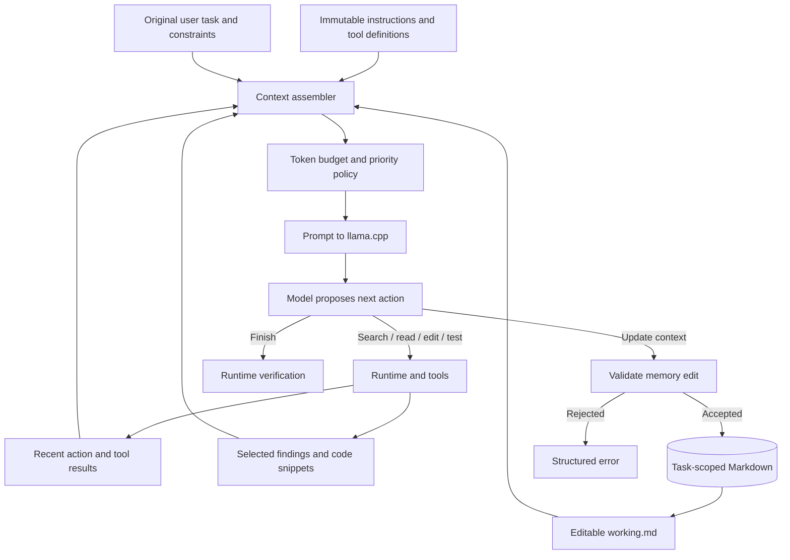

# Context and Memory

> **Status:** Implemented (Phase 5 + UI/runtime refinements): swappable `EditableContextStrategy`, `WorkingMemoryStore` (`working.md`, `task.md`, `findings/*.md`), `update_context` (`replace`/`append`), bounded `read_memory` (dynamically gated out of `response_schema` when `findings/` is empty and notes are untrimmed), and deterministic `TokenBudget` overflow pruning. See [`code-map.md`](code-map.md) and [`phase5-comparison-report.md`](phase5-comparison-report.md).  
> **Target:** Small quantized coding LLMs running locally on a 16 GB Apple Silicon MacBook Air.  
> **Related:** [Architecture](architecture.md) · [Agent Runtime](agent-runtime.md) · [Repository Retrieval](repository-retrieval.md) · [Benchmarking](benchmarking.md)

## 1. Purpose

The context-and-memory subsystem determines **what the model sees on each inference call**, what the agent may retain between calls, and how to keep that information useful under a constrained context and unified-memory budget.

Our primary hypothesis is that **model-initiated editing of a compact working context, combined with selective retrieval, can improve coding-task success relative to a conventional bounded-history baseline**. This is a hypothesis to test, not an established performance claim.

The harness controls the prompt and disk I/O. The LLM can **propose** changes to its editable notes through tools; it does not directly alter system instructions or write arbitrary memory files.

### Goals

- Preserve the original task and safety requirements across all iterations.
- Keep relevant findings, decisions, and progress available without replaying every tool result.
- Let the model proactively revise, correct, and prune its own working notes.
- Keep model input within an explicit token budget.
- Support identical runtime/tool policies across baseline and optimized experiments.
- Separate disk persistence, active model context, and inference-engine KV cache.
- Measure task success, context usage, latency, and actual RAM consumption.

### Non-goals for the MVP

- A separate LLM-based summarization/compression agent.
- Vector embeddings or a vector database.
- Long-term cross-project personal memory.
- Modifying llama.cpp internals or managing its KV cache directly.
- Assuming that fewer prompt tokens automatically mean less allocated RAM.

## 2. Three distinct kinds of “memory”

| Layer | Owner | Storage | Role |
| --- | --- | --- | --- |
| **Persistent task memory** | Python harness | Markdown on disk | Findings, working notes, progress retained across calls |
| **Active context** | Python context assembler | Prompt sent to model | Selected instructions, task, notes, code snippets, recent results |
| **Inference KV cache** | llama.cpp | Unified memory (RAM) | Accelerates attention over processed context tokens |

**Key distinction:** A 100 KB Markdown file on disk does not mean 100 KB of model context. Only the selected text that is inserted into the prompt consumes context tokens. Likewise, a smaller prompt does not necessarily lower *allocated* KV-cache RAM if llama.cpp reserves memory for a configured context window.

The model is logically stateless across independent requests unless context is resent. llama.cpp may reuse compatible cached prefixes, but that is an inference optimization, **not** a replacement for harness-managed memory. Rewriting earlier prompt content may reduce cache-prefix reuse.

## 3. Context architecture



The assembler is invoked **before every model call**. It constructs a bounded, ordered set of messages from available state. It must never blindly concatenate the full run history or entire repository.

## 4. Prompt composition and priority

Proposed ordering, from most protected to most expendable:

1. **Immutable harness instructions:** Role, tool protocol, safety, verification expectations.
2. **Immutable original task:** User request and authorized workspace constraints.
3. **Current execution state:** Latest action result, pending verification or approval, current step.
4. **Editable working context:** Concise hypotheses, decisions, next actions.
5. **Selected persistent findings:** Relevant saved facts and references.
6. **Retrieved repository excerpts:** Task-relevant bounded code snippets and file locations.
7. **Older recent-history entries:** Only if useful and within budget.

These categories have different trust levels. Repository content, tool output, and model-written notes are **untrusted task data**, never a source of new system or developer instructions.

### Example assembled prompt (conceptual)

```text
SYSTEM: You are a coding agent. Use approved tools only.
SYSTEM: Tool schemas and safety policy.

TASK (immutable):
Fix the failing token-validation test in this repository.

CURRENT STATE:
Last test failed: tests/test_auth.py::test_expired_token
Last edit: src/auth.py, lines 42–47

WORKING CONTEXT (editable):
- Suspected root cause: expiry comparison uses local time.
- Confirmed: tests construct UTC-aware timestamps.
- Next: inspect timestamp conversion and rerun targeted test.

RELEVANT CODE:
src/auth.py:42–47  [bounded, numbered excerpt]

RECENT RESULT:
pytest ... -> exit 1, assertion mismatch.

ASSISTANT: [next action]
```

Actual prompts will use the model's supported chat/template format. Do not treat this example as a literal wire protocol.

## 5. Persistent task-scoped Markdown layout

Proposed storage (exact placement is an open decision):

```text
.harness/
  runs/
    <run-id>/
      working.md
      task.md
      findings/
        authentication.md
        test-results.md
      artifacts/
        ...
```

### `working.md` — active editable memory

Short, high-value notes expected to be useful in the **next few steps**. The model may rewrite this file through `update_context`, subject to validation.

Suggested sections:

```markdown
# Working Context

## Goal
Fix the failing token-validation test.

## Confirmed Findings
- Expiry timestamps in the test are timezone-aware.
- Validation logic converts to naive local time.

## Current Hypothesis
The timezone conversion causes the mismatch.

## Next Action
Inspect the expiry comparison and patch it.

## Open Questions
- Are there other callers relying on naive timestamps?
```

Keep facts distinguishable from hypotheses. Replace stale hypotheses rather than accumulating contradictory notes. File paths and line references should be refreshed after edits when practical.

### `task.md` — durable progress record

Tracks progress, attempted approaches, verification evidence, and unresolved blockers. The **original user request remains separately immutable** in run metadata; the model cannot silently redefine success by editing `task.md`.

Suggested sections: goal summary, constraints, completed work, failed attempts, pending checks, and final outcome.

### `findings/*.md` — selective reference memory

Stores longer technical observations that may be useful later, but should **not** automatically be included in every prompt. A finding should identify its source (file, line range, test, or tool step) and when it was observed. Retrieval can surface selected findings as needed.

### Raw history is not working memory

The runtime retains an immutable event trail of model requests, tool calls, tool results, edits, and verification. SQLite is a supporting index/metrics store; large artifacts may be stored on disk. The model cannot erase or rewrite this history by pruning `working.md`.

## 6. CLM-inspired self-editing context

**MVP tool contract:** The model-facing `update_context` tool is normalized by the LLM adapter into a `context_edit` runtime action. It is the only working-note write tool initially. A bounded `read_memory` tool may retrieve selected findings as needed; a separate `save_memory` tool is deferred. The harness persists accepted edits itself.

Our design borrows the **principle of model-directed context maintenance**: the model decides when its editable notes have become noisy, outdated, or insufficient, and proposes changes.

This is **not** a claim that we are reproducing a particular research implementation exactly. The MVP focuses on a practical, auditable, task-scoped working-memory mechanism.

### Allowed operations

A normalized `update_context` action can support:

| Operation | Meaning | Example |
| --- | --- | --- |
| `replace` | Replace the entire editable working context | Rewrite after root cause confirmed |
| `append` | Add a concise new finding or next step | Record an observed failing test |
| `prune` | Remove obsolete content by section or explicit range | Drop disproven hypothesis |
| `patch` (later) | Apply a structured edit to a named section | Update only “Next Action” |

For the MVP, **`replace` and `append` may be sufficient**; explicit `prune` can be represented by a replacement. Avoid building a complex editing language before testing model reliability.

Example normalized request:

```json
{
  "kind": "context_edit",
  "operation": "replace",
  "target": "working.md",
  "content": "# Working Context\n\n## Confirmed Findings\n- ..."
}
```

The harness checks the target, operation, byte/token size, task scope, and immutable-boundary rules before writing. Rejected edits return a concise structured error. Writes should be atomic; accepted edits should be versioned or logged for later analysis.

### When should the model edit context?

Potential triggers:

- A hypothesis was disproven and should be removed.
- A root cause or important dependency was confirmed.
- A test result changes the plan.
- The task moves from exploration to implementation or verification.
- The working notes approach a configured size threshold.

**Do not require a context edit every step.** Each edit costs a model action and may increase latency. Whether model-initiated edits are frequent enough—or reliable enough—to help is part of the evaluation.

### Protect against memory drift

- Keep the original task and explicit user constraints immutable.
- Label uncertain observations as hypotheses.
- Keep source references for important claims.
- Do not let the model declare tests passed unless trace evidence supports it.
- Reject edits to policy, tool schemas, and unrelated run directories.
- Retain an append-only trace of edits even when the working file is replaced.

## 7. Deterministic token-budget management

The context manager must enforce a hard budget **before** calling the model.

Let:

- `W` = configured model context capacity.
- `R` = reserved output tokens.
- `H` = prompt-template/tool-schema overhead and safety margin.
- `B = W - R - H` = maximum input content budget.

Allocate `B` among immutable instructions, task, current state, working notes, snippets, findings, and recent history. Use the **model-compatible tokenizer or llama.cpp token-counting support** where practical; character/word estimates alone are not sufficiently reliable near the limit.

### Overflow policy

1. Always preserve immutable instructions, tool schema, original task, and essential current state.
2. Drop the oldest low-value history entries.
3. Reduce the number or size of retrieved code snippets.
4. Omit nonessential findings.
5. Trim editable working notes using a **deterministic, documented rule**, while preserving explicit required constraints.
6. If even protected content cannot fit, stop with a clear `context_budget_exceeded` error.

This fallback is a guardrail, **not** a separate LLM summarizer. Log every fallback so benchmarks can distinguish proactive model edits from emergency pruning.

### Context allocation example

The following is illustrative only, not a final default:

| Category | Example cap |
| --- | ---: |
| Instructions and tool schemas | 1,000 tokens |
| Original task and state | 700 tokens |
| Working notes | 1,200 tokens |
| Repository snippets | 2,500 tokens |
| Recent results and findings | 1,000 tokens |
| Output reserve and margin | Remaining window |

The actual budget must be validated against the chosen model, chat template, tools, and configured context capacity. A static category allocation may waste tokens; a priority-based allocator with caps is preferable.

## 8. Context strategies and experimental isolation

The runtime uses a swappable context strategy:

```python
class ContextStrategy:
    def build(self, run) -> list[dict]: ...
    def observe(self, run, action, result) -> None: ...
    def apply_edit(self, run, action): ...
```

### Baseline strategy

- Immutable task and instructions.
- Bounded recent conversation/tool history.
- Same model, tool policy, context capacity, and execution limits.
- No model-editable working context.

### Editable-context strategy

- Same immutable task and tool policy.
- Compact `working.md` maintained through model-proposed edits.
- Selected recent tool results and task findings.
- Same maximum prompt capacity as baseline.

### Retrieval as an independent axis

Repository retrieval must be independently enabled or disabled so that experiments can compare:

1. Baseline.
2. Enhanced retrieval only.
3. Editable context only.
4. Both techniques together.

Do not let the optimized strategy quietly receive extra tools, larger windows, or more verification attempts than baseline. If `update_context` is enabled only in the editable-memory condition, account for its extra model calls/steps explicitly; keep comparable **resource budgets**, and document the allowed capability difference.

## 9. Retrieval interaction

Context management decides **how much** retrieved code enters the prompt; the retrieval subsystem decides **which code** is relevant.

Suggested retrieval workflow:

1. Agent issues a bounded search or symbol lookup.
2. Retrieval returns paths, line ranges, and concise snippets.
3. Context manager chooses the most useful items within the current budget.
4. Working notes store stable findings and file references, not entire copied source files.
5. Agent can re-read source as needed to avoid acting on stale snippets.

A file reference in memory is a pointer, **not proof** that the referenced code still has the same contents. Edits can invalidate line numbers or conclusions.

## 10. Unified-memory implications on 16 GB Apple Silicon

Approximate major memory consumers:

- **Quantized model weights:** Mostly fixed for a selected model/quantization.
- **KV cache:** Depends on architecture, configured context capacity, cache precision, and llama.cpp allocation behavior.
- **Inference buffers:** Depend on model, batch settings, backend, and runtime.
- **macOS, Python, tests, and other processes:** Share unified memory.

For an illustrative architecture with 28 layers, 4 KV heads, 128 head dimension, and 2 bytes per K/V element:

```text
KV bytes ≈ 2 × layers × KV_heads × head_dim × tokens × bytes_per_element

8K tokens  ≈ 0.44 GiB
32K tokens ≈ 1.75 GiB
```

These are **illustrative architecture-dependent estimates**, not measured values for our eventual model. Real memory use can differ substantially, and llama.cpp may allocate for a configured capacity even when fewer tokens are used.

### What to measure

- Peak system/unified memory during a run, with a documented collection method.
- Process-specific memory where available.
- Configured context capacity versus actual input tokens.
- Token counts per inference request and cumulative totals.
- Time to first token, total inference time, and task wall time where available.
- Task success against an independent test oracle.

The strongest claim would be that our approach achieves **better task success at the same memory/context configuration**, or **comparable success with a smaller configured context window**. Do not claim RAM savings solely because Markdown notes or prompt text got shorter.

## 11. Safety, integrity, and durability

- Treat model-written memory as untrusted data.
- Never interpolate note content into a privileged instruction role.
- Scope memory paths by run ID and validate against traversal/symlink escapes.
- Write atomically and preserve edit history in structured events.
- Bound the size of each file and each model-visible excerpt.
- Avoid saving secrets from source files or environment variables into memory.
- Separate workspace code edits from memory edits: `update_context` cannot modify repository source.
- Do not automatically share task notes across runs.
- If a memory write fails, return an explicit error; do not pretend the model's notes were saved.

## 12. Proposed module boundaries

```text
src/harness/
├── context/
│   ├── manager.py       # Prompt assembly and budget enforcement
│   ├── strategies.py    # Baseline and editable-context strategies
│   └── budgeting.py     # Token counting and deterministic fallback
├── memory/
│   ├── store.py         # Scoped Markdown reads and atomic writes
│   └── edits.py         # Validation and normalized edit operations
├── agent/
│   └── runtime.py       # Uses strategy interface; does not own note files
└── storage/
    └── database.py      # Supporting trace/metric storage
```

Names and files are provisional. Prefer a smaller implementation until responsibilities justify splitting modules.

## 13. Testing plan

### Unit tests

- Prompt assembler never omits protected instructions or the original task.
- Budget calculations reserve output capacity and enforce the actual token limit.
- Invalid targets, path traversal, symlink escapes, and oversized edits are rejected.
- Replace/append operations produce expected Markdown and atomic writes.
- Truncation and fallback are deterministic and logged.
- Separate runs cannot read each other's notes without explicit authorization.
- Model-generated memory cannot change tool permissions or verification policy.

### Integration tests

With a fake deterministic LLM:

1. Start with a coding task and an empty `working.md`.
2. Read code and observe a failing test.
3. Save a tentative hypothesis.
4. Discover contradictory evidence.
5. Replace the hypothesis with a confirmed finding.
6. Verify that the next prompt contains the new finding but not the obsolete one.
7. Finish and inspect the memory-edit trace.

Add tests for long histories, missing/corrupt notes, context overflow, stale file references, and interrupted writes.

### Experimental evaluation

- Compare baseline, retrieval-only, editable-context-only, and combined modes.
- Pin model, quantization, inference settings, workspace snapshot, task suite, and budgets.
- Track both **success** and **overhead**: memory-edit actions may cost more tokens/time than they save.
- Test whether model-generated notes introduce errors, omit crucial constraints, or drift away from the task.
- Include ablations at multiple **configured context capacities**, e.g., 8K and 16K, rather than assuming shorter prompts reduce peak RAM.

## 14. Implementation milestones

The phase ordering in [Development Roadmap](development-roadmap.md) is authoritative: the bounded-history baseline and instrumentation come first (Phases 2–4), followed by editable context (Phase 5). The steps below are subsystem-specific, not a separate overall schedule.

1. Implement a simple bounded-history baseline context builder.
2. Add model-compatible token counting, reserves, and overflow handling.
3. Implement run-scoped Markdown storage with atomic writes.
4. Define and validate `update_context` actions.
5. Implement editable working-context assembly and edit logging.
6. Add selective findings retrieval and integrate repository snippets.
7. Benchmark quality, token usage, latency, and unified-memory behavior.
8. Refine context-edit triggers and budgets based on measured results.

## 15. Open design decisions

- Which GGUF model and tokenizer/tool protocol to standardize on first.
- Whether task memory is stored inside ignored `.harness/` or in a user-level application-data directory.
- Exact note size limits, prompt budget caps, and fallback ordering.
- Whether to expose only `replace` and `append` initially.
- How to detect stale findings after repository modifications.
- Whether the model may edit `task.md` directly or only update progress via a separate structured tool.
- How to measure unified-memory peaks consistently on macOS.
- Whether proactive editing requires explicit prompt nudges or is fully discretionary.

---

**Guiding principle:** The harness must preserve correctness and safety even if a small model manages its notes poorly. The research question is whether **better self-maintained context helps the model solve more coding tasks under the same constrained resources**.
