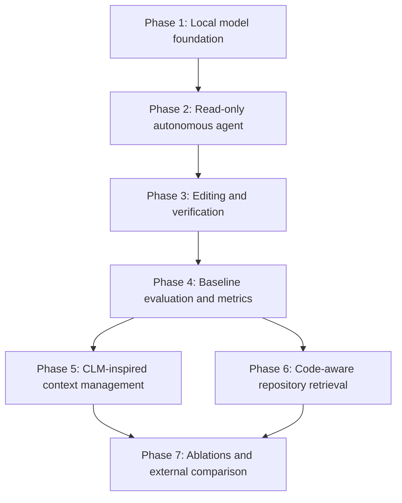

# Development Roadmap

> **Status:** Phase 1, Phase 2, and Phase 3 post-edit verification and no-progress handling are implemented, with deterministic tests and a successful local multi-file smoke test. Task fixture isolation remains future work.
> **Target:** A local-first CLI coding agent running a small quantized LLM on a 16 GB Apple Silicon MacBook Air.  
> **Approach:** Build a functioning baseline first, add one capability at a time, and measure each change.  
> **Related:** [Architecture](architecture.md) · [Agent Runtime](agent-runtime.md) · [Context and Memory](context-and-memory.md) · [Repository Retrieval](repository-retrieval.md) · [Benchmarking](benchmarking.md)

## 1. Development principles

1. **Vertical slices over broad scaffolding.** Each phase should result in an end-to-end behavior that can be demonstrated and tested.
2. **Baseline before optimization.** Build a simple functioning coding agent before adding CLM-inspired memory or Tree-sitter retrieval.
3. **Measure before claiming improvements.** Establish evaluation and metrics before experimenting with context and retrieval techniques.
4. **Keep the architecture modular, but avoid premature abstraction.** Introduce interfaces where a second implementation or a real testing need justifies them.
5. **Keep local hardware constraints visible.** Use a single model, bounded context, one task at a time, and explicit resource limits.
6. **Treat model actions as untrusted requests.** Python owns file access, execution policy, approvals, and stopping conditions.
7. **Test normal and failure paths.** An agent must behave predictably when the model emits malformed actions, tests fail, or limits are reached.
8. **Document decisions and limitations.** Record why implementation choices were made and where results remain uncertain.

Each feature should follow a short cycle: **define behavior → implement the smallest version → test → inspect failures → refactor**.

## 2. Roadmap overview

**This document is the authoritative project-wide implementation order.** Milestone lists in the architecture and subsystem documents provide technical breakdowns, not alternative schedules.



Phases 5 and 6 can be developed independently once the baseline is measurable. Integrate them together only after each works separately.

| Phase | Primary deliverable | Exit criterion |
| --- | --- | --- |
| 1. Local model | Python ↔ llama.cpp | Python receives a local model response |
| 2. Read-only agent | Bounded agent loop | Agent autonomously inspects multiple files |
| 3. Coding agent | Edit + test + retry | Agent fixes a deliberately broken fixture |
| 4. Baseline evaluation | Repeatable task runner and metrics | Baseline outcomes and resource measurements are recorded |
| 5. Editable context | Working Markdown notes and context strategy | Agent revises useful notes across calls within a budget |
| 6. Repository retrieval | ripgrep + Tree-sitter code-aware results | Agent locates relevant symbols without reading entire files |
| 7. Benchmarking | Internal ablations and external comparison | Reproducible results and limitations are published |

These are milestone gates, **not estimates of calendar duration**.

## 3. Phase 1 — Local model foundation

### Objective

Prove that a quantized coding model can run locally and receive a Python chat request. Do not build an agent loop yet.

### Implementation tasks

- [x] Initialize a Python package using `pyproject.toml` and a `src/harness/` layout.
- [x] Set up a virtual environment, formatter/linter, and `pytest`.
- [x] Install or obtain a working `llama.cpp` / `llama-server` build for Apple Silicon.
- [x] Choose an initial small GGUF coding model and quantization based on actual memory behavior.
- [x] Run the model server with a deliberately bounded context window (8K is a candidate, not a hard requirement).
- [x] Write a minimal Python HTTP client that sends a chat request and prints the response.
- [x] Capture model errors, timeouts, response text, and token usage when available.
- [x] Document the tested model, server arguments, and observed memory behavior.

### Tests

- [x] Mocked HTTP response is parsed correctly.
- [x] Connection refusal and timeout produce clear errors.
- [x] A real local smoke test receives a valid response.

### Deliverable

```text
Python script → local llama-server → GGUF model → response
```

**Done when:** One Python command reliably sends a prompt to the local model and displays its response without requiring cloud inference.

**Avoid:** Adding a database, tools, memory, or a frontend during this phase.

## 4. Phase 2 — Read-only autonomous agent

### Objective

Build the smallest useful multi-step agent: it can inspect a repository and answer a question by choosing its own next actions.

### Implementation tasks

- [x] Define a minimal `AgentRun` state and terminal statuses.
- [x] Define and strictly parse normalized `tool`, `complete`, and `invalid` actions; add `context_edit` in Phase 5 when the model-facing `update_context` tool is introduced.
- [x] Add `list_files` and bounded `read_file` tools.
- [x] Implement tool schema validation and workspace-root restrictions.
- [x] Implement the read-only loop: assemble bounded prompt → call injected model → parse action → execute tool → record observation.
- [x] Limit model calls and prompt bytes.
- [x] Add maximum steps, timeouts, and cancellation checks.
- [x] Support model-declared completion while distinguishing the model's proposal from verification evidence.
- [x] Add a basic CLI command such as `harness run "Explain this module" --repo ./repo`.
- [x] Use a fake model callable for deterministic loop tests.

### Tests

- [x] A deterministic runtime test reads two fixture files without an additional user prompt.
- [x] Invalid tool names and malformed arguments are rejected (`tests/test_agent_runtime.py`).
- [x] Paths outside the workspace are rejected, including symlink escapes (`tests/test_repository_tools.py`).
- [x] An endlessly requesting fake model stops at its configured limit (`tests/test_agent_runtime.py`).
- [x] Model timeouts and malformed responses produce concise CLI failure reports.

### Deliverable

A **read-only local repository assistant** with a functioning bounded agent loop.

**Done when:** The agent can answer a question about a small fixture repository by autonomously inspecting relevant files. Deterministic CLI/runtime integration is covered; a successful live smoke run on 2026-11-03 is recorded in [Local model setup](local-model.md). This is smoke evidence, not a correctness or reliability benchmark.

**Avoid:** Building sophisticated state machines or abstractions before the simple loop is reliable.

## 5. Phase 3 — Coding and verification

### Objective

Extend the read-only agent into a coding agent that can find code, make changes, run tests, and respond to failures.

### Implementation tasks

- [x] Add a bounded `search_code` tool using ripgrep (basic lexical search only).
- [x] Add an authorized exact-text `edit_file` tool with hash preconditions, bounded diff recording, and atomic single-file replacement.
- [x] Add `run_tests` using a fixed pytest command, configured workspace-relative targets, bounded output, and subprocess timeouts.
- [x] Define separate edit/test approval modes (`AUTO`, `ASK`, `DENY`) with opt-in CLI approval and explicit `--auto-approve` grants.
- [x] Return structured tool results, including failed tests, conflicts, timeout, cancellation, and uncertain edit write states.
- [x] Implement runtime verification using recorded test evidence **after the last relevant edit**; distinguish model completion proposals from runtime verification and independent benchmark resolution.
- [x] Report final diff, executed checks, unresolved issues, and terminal status.
- [x] Add no-progress detection for repeated identical actions.
- [ ] Test clean-workspace preparation and isolation for fixture tasks.

### Tests

- [ ] Agent fixes a deliberately broken function in a small repository.
- [x] Agent runs a targeted test after editing in deterministic runtime coverage.
- [ ] A failed test can lead to another edit and a successful retry.
- [x] A model's unsupported claim that tests passed is rejected.
- [x] Arbitrary commands and out-of-workspace edits are denied.
- [x] Test timeout and partial tool output are bounded and reported; edit replacement uncertainty is audited.

### Deliverable

A **minimal local coding agent** that can complete a small end-to-end edit-and-test task.

**Done when:** On a controlled fixture, the agent produces a patch and passes the task's independent test oracle.

**Security note:** Virtual environments isolate dependencies, not untrusted code. Running repository tests requires an explicit trust policy; do not treat a path check as a full sandbox.

## 6. Phase 4 — Baseline evaluation and instrumentation

### Objective

Create a measurable baseline **before** introducing retrieval or memory optimizations.

### Implementation tasks

- [ ] Define structured run/step events and stable outcome labels.
- [ ] Record model calls, input/output tokens, tool calls, context size, wall time, and verification results.
- [ ] Add SQLite for structured traces and metrics where useful; keep the runtime independent of its persistence backend.
- [ ] Save run-specific patches, logs, and configuration metadata.
- [ ] Build a fixture-based evaluation runner with clean checkout and separate evaluation workspace.
- [ ] Establish a documented macOS memory measurement procedure.
- [ ] Select five feasible real benchmark tasks for smoke testing; document selection and exclusions.
- [ ] Separate development tasks from future held-out tasks.
- [ ] Run the baseline repeatedly to confirm the runner produces interpretable results.

### Tests

- [ ] Each run has a unique ID and complete terminal outcome.
- [ ] Model/tool failures are recorded rather than silently discarded.
- [ ] A candidate patch is evaluated against a clean task snapshot.
- [ ] Setup failures are distinguished from unresolved coding tasks.
- [ ] Re-running the same fixture does not reuse prior edits or working memory.

### Deliverable

A **reproducible baseline agent and evaluation pipeline** with initial results.

**Done when:** The same task can be rerun under pinned settings, with a saved patch, evaluation result, token counts, timing, and documented memory observations.

**Avoid:** Calling a custom local SWE-bench subset an official SWE-bench score.

## 7. Phase 5 — CLM-inspired context management

### Objective

Test whether model-initiated editing of compact working notes improves coding success under a fixed context budget.

### Implementation tasks

- [ ] Extract the existing bounded-history prompt builder behind a small context-strategy interface.
- [ ] Implement run-scoped Markdown storage for `working.md`, `task.md`, and optional `findings/`.
- [ ] Keep original task and harness instructions immutable.
- [ ] Add the model-facing `update_context` tool, normalized by the LLM adapter to the runtime's `context_edit` action, with validated `replace` and `append` operations.
- [ ] Add bounded `read_memory` for selective findings retrieval when needed; defer a separate `save_memory` tool.
- [ ] Use atomic writes and record accepted/rejected context edits.
- [ ] Add model-compatible token counting and deterministic overflow handling.
- [ ] Selectively assemble working notes, recent results, and relevant findings.
- [ ] Log proactive context edits separately from fallback pruning.
- [ ] Compare the editable-context strategy with the same baseline on development tasks.

### Tests

- [ ] Model can replace a disproven hypothesis with a confirmed finding.
- [ ] Updated notes appear in a later prompt.
- [ ] Immutable task/instructions cannot be modified through memory tools.
- [ ] Oversized or out-of-scope edits are rejected.
- [ ] Context never exceeds the configured input budget.
- [ ] Run-specific notes do not leak into another task.

### Deliverable

A **swappable editable-context strategy** with testable memory behavior.

**Done when:** The agent can proactively maintain its working notes across multiple calls and the harness enforces size and safety constraints.

**Research gate:** Measure whether context editing helps, hurts, or adds too much overhead. Do not assume it is beneficial.

## 8. Phase 6 — Code-aware repository retrieval

### Objective

Give the agent better code discovery without requiring it to read large parts of a repository.

### Implementation tasks

- [ ] Reuse and harden the Phase 3 ripgrep adapter.
- [ ] Add Tree-sitter parsing for Python source files first.
- [ ] Extract functions, classes, methods, imports, and source ranges.
- [ ] Build a compact repository map of symbol names and locations.
- [ ] Add deterministic candidate ranking and bounded snippet formatting behind the existing `search_code` / `read_file` interfaces; defer extra model-facing symbol tools.
- [ ] Invalidate affected index entries after edits or external file changes.
- [ ] Handle unsupported languages and parser failures by falling back to lexical search.
- [ ] Integrate snippet selection with the global context budget.
- [ ] Keep retrieval independently switchable from editable context.
- [ ] Compare lexical-only and code-aware retrieval on development tasks.

### Tests

- [ ] Definitions rank above incidental mentions in a controlled fixture.
- [ ] Symbol locations and snippet line numbers are correct.
- [ ] Index updates after edits, renames, and deletions.
- [ ] Large/ignored/generated files are handled within limits.
- [ ] Parsing failures do not prevent basic file search.
- [ ] The agent can locate a relevant symbol in a multi-file fixture.

### Deliverable

A **local code-aware retrieval subsystem** using ripgrep and Tree-sitter.

**Done when:** The agent can retrieve compact, relevant code excerpts from a multi-file repository without indiscriminately loading whole files.

**Research gate:** Compare accuracy and overhead; an improved retrieval score alone does not prove improved task resolution.

## 9. Phase 7 — Ablations, external comparison, and optimization

### Objective

Evaluate whether our techniques improve coding-task resolution and resource efficiency, and compare against an established lightweight harness.

### Implementation tasks

- [ ] Run four internal conditions: baseline, retrieval-only, CLM-only, combined.
- [ ] Pin the same model, quantization, context capacity, task set, and evaluation oracle.
- [ ] Start with an 8K context capacity; evaluate 16K only if stable and feasible.
- [ ] Add mini-SWE-agent as an external comparison using the same local model and selected tasks.
- [ ] Document differences in prompts, tools, permissions, and execution policies.
- [ ] Expand from five smoke tasks to a proposed 20-task evaluation and potentially 50 tasks.
- [ ] Use separate held-out tasks for reported results.
- [ ] Record task resolution, peak memory, tokens, calls, wall time, and failure reasons.
- [ ] Repeat trials where feasible and report uncertainty and per-task regressions.
- [ ] Validate selected patches with an official-compatible evaluator if practical.
- [ ] Publish a reproducible report with negative results and limitations.

### Tests

- [ ] Each condition starts from the same repository snapshot.
- [ ] Evaluation patches cannot access reference solutions.
- [ ] Task manifests and results contain enough metadata to reproduce runs.
- [ ] Locally validated results are not mislabeled as official benchmark scores.
- [ ] Metrics are collected consistently across conditions.

### Deliverable

A **benchmark report** comparing our harness strategies and an external harness on real coding tasks.

**Done when:** We can substantiate, qualify, or reject the original hypotheses with reproducible evidence.

## 10. Suggested initial project structure

Build this **gradually** rather than creating every file on day one:

```text
efficient-code-agent/
├── README.md
├── docs/
│   ├── architecture.md
│   ├── agent-runtime.md
│   ├── context-and-memory.md
│   ├── repository-retrieval.md
│   ├── benchmarking.md
│   └── development-roadmap.md
├── src/
│   └── harness/
│       ├── cli.py
│       ├── agent/
│       ├── llm/
│       ├── tools/
│       ├── context/
│       ├── memory/
│       ├── retrieval/
│       └── storage/
├── tests/
├── benchmarks/
└── pyproject.toml
```

At the end of Phase 1, it is perfectly acceptable for `src/harness/` to contain only a minimal model client and CLI entry point.

## 11. Definition of done for every feature

Before marking an implementation task complete:

- [ ] The expected behavior is described clearly.
- [ ] A normal case works end-to-end.
- [ ] At least one relevant failure/edge case is tested.
- [ ] Errors are visible and actionable.
- [ ] Resource or safety limits are enforced where relevant.
- [ ] The code is understandable and avoids unnecessary abstractions.
- [ ] Documentation is updated if an interface or design decision changed.
- [ ] Changes are committed in a reviewable unit.

## 12. Development workflow and Git practices

- Use small, focused GitHub issues tied to phase acceptance criteria.
- Keep documentation and implementation changes reviewable.
- Prefer short-lived feature branches and pull requests rather than a long-running unreviewed implementation branch.
- Add automated unit tests early; introduce CI when a minimal test suite exists.
- Do not block the initial local-model proof of concept on elaborate CI/CD.
- Record major decisions in the relevant design document or a short decision log.
- Revisit the roadmap after each phase based on measured results and newly discovered constraints.

### Example first issues

1. Initialize Python package and test tooling.
2. Document and smoke-test local llama.cpp setup.
3. Implement a minimal local LLM HTTP client.
4. Add client tests for success, timeout, and connection failure.
5. Implement a fake LLM adapter and bounded read-only agent loop.

## 13. Risks and mitigation

| Risk | Mitigation |
| --- | --- |
| Model is too large for 16 GB | Test smaller quantizations/models and reduce configured context |
| Small model cannot reliably call tools | Choose a compatible chat template; validate structured output early |
| Agent loops without progress | Step/time/token limits and repeated-action detection |
| Context edits erase useful information | Immutable task, edit trace, source references, deterministic fallback |
| Tree-sitter complexity grows | Start with Python symbols only; add languages after a working prototype |
| Benchmark tasks overwhelm the Mac | One task/model at a time; select feasible tasks; separate official evaluation |
| Tests or tools alter the host unexpectedly | Explicit permissions, isolated workspaces, bounded commands |
| Optimization improves tokens but not success | Keep task resolution primary; report negative findings |

## 14. Open decisions

Resolve these **when the relevant phase begins**, rather than blocking earlier milestones:

- Initial coding GGUF model and quantization.
- llama.cpp server settings and tool-call response protocol.
- Exact action schemas, patch format, and approval behavior.
- Default step, token, context, and wall-time budgets.
- Markdown memory placement and edit operation scope.
- Tree-sitter language support beyond Python.
- Local benchmark task manifest and test oracle.
- Official-compatible evaluation environment and reporting conventions.

---

**Guiding principle:** Start with the smallest agent that works, then improve it through controlled experiments. Each phase should leave behind a usable capability, tests, and evidence—not merely more scaffolding.
