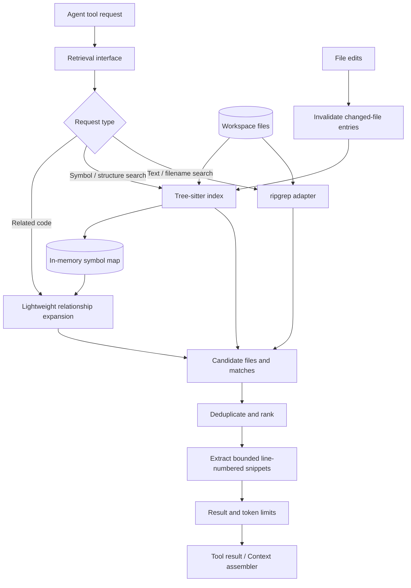

# Repository Retrieval

> **Status:** Implemented (Phase 3 bounded lexical `search_code` + Phase 6 Tree-sitter Python `CodeAwareRetrievalBackend`, cached `RepoSymbolIndex`, deterministic definition-above-comment ranking, and bounded line-numbered snippets). See [`code-map.md`](code-map.md) and [`phase6-comparison-report.md`](phase6-comparison-report.md).
> **Target:** Small quantized coding LLMs on a 16 GB Apple Silicon MacBook Air.  
> **Related:** [Architecture](architecture.md) · [Agent Runtime](agent-runtime.md) · [Context and Memory](context-and-memory.md) · [Benchmarking](benchmarking.md)

## 1. Purpose

The repository-retrieval subsystem helps a small local coding model **find the right code without placing the entire repository in its prompt**. It combines fast lexical search with lightweight syntax-aware indexing, then returns bounded, source-referenced results.

The research hypothesis is that **relevant, compact code context improves coding-task success at a fixed model and context budget** compared with basic file and text search alone. This must be measured rather than assumed.

### Goals

- Locate relevant files, functions, classes, imports, and tests quickly.
- Return accurate paths and line-numbered snippets that fit the context budget.
- Use **ripgrep** for lexical discovery and **Tree-sitter** for syntax-aware structure.
- Avoid full repository ingestion, vector infrastructure, and expensive global analysis in the MVP.
- Keep the index consistent enough to work after the agent edits files.
- Support an independently switchable retrieval enhancement for fair ablations.
- Operate entirely locally and safely on repositories of varying sizes.

### Non-goals for the MVP

- Full semantic understanding, type checking, or whole-program call graphs.
- Embedding generation, vector search, or external search services.
- Automatic indexing of every dependency, binary, generated file, or secret.
- Guaranteeing that a retrieved snippet contains the actual bug.
- Building a general-purpose language server or IDE.

## 2. System overview



**Responsibility boundary:** Retrieval discovers and formats candidate code. The **context manager** decides which returned excerpts enter the next model prompt. The **agent runtime** owns tool dispatch, safety, budgets, and logging. The LLM chooses when to search or read; it does not directly execute ripgrep or Tree-sitter.

## 3. Technology choices

| Technology | Use | Why |
| --- | --- | --- |
| **ripgrep (`rg`)** | Text, regex, and filename search | Fast, mature, local, respects common ignore rules |
| **Tree-sitter** | Parse source structure and extract symbols | Incremental-friendly parsing, useful even for incomplete code |
| **Python** | Orchestration, indexing, ranking, snippet formatting | Keeps harness simple and easy to test |
| **Markdown memory** | Store durable findings and code references | Keeps active context concise; not the retrieval index itself |
| **SQLite (optional)** | Log search events and benchmark metrics | Supporting observability; not required for retrieval |

Tree-sitter produces **syntax trees**, not automatically a cross-file semantic dependency graph. Import and reference relationships are best-effort heuristics built by our Python code.

## 4. Retrieval modes and interfaces

### 4.1 Baseline search

The baseline agent receives basic, bounded tools:

- `list_files(directory?, pattern?)`
- `search_code(query, glob?, max_results?)`
- `read_file(path, start_line, end_line)`

The implemented `search_code` uses ripgrep regular-expression syntax for
`query`; `glob` is a separate positive Python `Path.match` filename filter.
It returns `{query, matches}` where each match contains a workspace-relative
`path`, 1-based `line`, and single-line `preview`. Results are deduplicated and
sorted by path and line. The request accepts at most 4096 UTF-8 query bytes,
defaults to 50 results (maximum 200), scans files up to 1 MiB, limits previews
to 512 UTF-8 bytes, bounds ripgrep output and serialized output to 64 KiB and
32 KiB respectively, and uses one five-second deadline for regex validation
and search. Results mark truncation when a bound clips results or previews.
Hidden paths and generated directories are excluded, normal ripgrep ignore
rules apply, and a user glob cannot override either filter. A successful empty
result means no matches were found within that bounded visible search; it does
not establish absence from ignored or excluded files.

These are sufficient for a minimal coding agent. They remain available in all experimental modes.

### 4.2 Enhanced code-aware retrieval

**MVP decision:** Preserve the baseline model-facing repository tool interface (`list_files`, `search_code`, `read_file`) and enhance search ranking, snippets, and symbol-aware discovery behind those tools. The additional tool names below are **possible later extensions**, not required MVP tools. This minimizes tool-schema differences in the internal ablations.

The optimized variant adds or enriches:

- `search_symbols(name, kind?, path_filter?)`
- `get_repo_map(scope?, max_symbols?)`
- `get_symbol_context(path, symbol, include_related?)`
- Ranked code snippets returned by existing search tools, where appropriate.

**Experimental caution:** Adding new tools changes the model's available capabilities and tool-schema tokens. Benchmarking should document this explicitly. Where practical, expose a **common tool interface** in all modes and vary the retrieval implementation or returned context instead, so improvements can be attributed more cleanly.

### Proposed normalized search result

```json
{
  "query": "validate_token",
  "results": [
    {
      "path": "src/auth.py",
      "start_line": 38,
      "end_line": 57,
      "symbol": "validate_token",
      "kind": "function",
      "reason": ["exact_symbol_match", "test_reference"],
      "score": 8.5,
      "snippet": "38: def validate_token(token):\n39:     ..."
    }
  ],
  "truncated": false,
  "index_revision": "workspace-snapshot-id"
}
```

Scores are **internal ranking heuristics**, not probabilities or correctness confidence. The snapshot ID is a conceptual index-version marker, not a required Git commit.

## 5. Workspace discovery and file selection

Before parsing, establish a safe, bounded set of candidate files.

1. Canonicalize and validate the workspace root.
2. Enumerate tracked or visible files using an efficient local mechanism.
3. Respect `.gitignore`, configured ignore patterns, and common generated directories.
4. Restrict indexing to supported source languages and a configurable maximum file size.
5. Skip binary files, vendor trees, build artifacts, and known secret files by default.
6. Record excluded-file counts and reasons for diagnostics.

Possible default exclusions: `.git/`, `node_modules/`, `.venv/`, `dist/`, `build/`, coverage output, minified assets, and binary files. **Do not hardcode exclusions that silently hide task-relevant code**; allow explicit user-approved overrides.

Symlinks must not permit reads outside the authorized workspace. Ignore rules reduce noise but are **not a security boundary**.

## 6. ripgrep-based lexical search

Use `rg` for:

- Exact names, identifiers, error messages, and configuration keys.
- Regex patterns and test names.
- Filename and path discovery.
- Locating references to a symbol across files.

Illustrative commands:

```bash
rg -n --glob '*.py' 'validate_token' .
rg --files -g '*.py'
rg -n 'expired token|TokenExpired' tests src
```

The harness should invoke ripgrep using a **subprocess argument list**, not interpolate model input into a shell command. Enforce a timeout, working-directory restriction, maximum results, and maximum output bytes. Treat search patterns as data; avoid exposing arbitrary flags to the model.

### Result handling

- Parse path, line number, and match text.
- Normalize paths relative to the workspace.
- Deduplicate repeated matches.
- Return a concise preview plus explicit truncation information.
- Prefer targeted searches to dumping entire matching files.

A search with no matches is valid feedback, not necessarily an agent failure.

## 7. Tree-sitter syntax-aware index

Tree-sitter helps build a compact view of **where code is defined and how files are structured**.

### 7.1 Initial language scope

Start with **Python**, because the harness itself is Python and parser integration can be tested on the project. Expand to TypeScript/JavaScript only after the Python pipeline is stable. Supported languages should be explicit and configurable.

### 7.2 Indexed data

For each supported file, extract:

| Field | Example | Purpose |
| --- | --- | --- |
| Relative path | `src/auth.py` | Locate source |
| Language | `python` | Select parser |
| Symbol name | `validate_token` | Match task terms |
| Symbol kind | `function` | Filter and rank |
| Parent symbol | `AuthService` | Show structural nesting |
| Start/end lines | `38–57` | Retrieve exact code |
| Signature/header | `def validate_token(token):` | Compact repository map |
| Imports | `from datetime import timezone` | Best-effort related-file discovery |
| File fingerprint | Hash or metadata | Invalidate stale entries |

For Python, a first-pass extractor can identify classes, functions, methods, and import statements. **Definitions are easier to index reliably than references or call edges.** Do not present inferred call relationships as verified semantic facts.

### 7.3 Example repository map

```text
src/
  auth.py
    function validate_token(token)        L38–57
    class AuthService                    L60–114
      method authenticate(self, token)    L72–91
  users.py
    function get_user_by_id(user_id)      L15–31
tests/
  test_auth.py
    function test_expired_token()         L12–26
```

The map intentionally excludes most function bodies. The agent can request a specific definition or line range when it needs details.

### 7.4 Index lifecycle

- Build lazily on the first symbol-aware request, or index a bounded candidate set at run start.
- Cache parsed symbols in memory for the current run.
- On an approved file edit, invalidate and reparse affected files.
- Detect external file changes using fingerprints before trusting cached line ranges.
- Fall back to lexical search and bounded reads when parsing fails or a language is unsupported.

Avoid an expensive full-repository parse on every model turn. A first MVP may use **on-demand parsing** rather than a persistent index database.

## 8. Candidate generation and ranking

The retrieval pipeline should be simple enough to explain and benchmark.

### 8.1 Candidate sources

1. Exact filename/path match.
2. Exact symbol-name match.
3. ripgrep text matches.
4. Relevant test files.
5. Files connected by imports or local references, when cheaply inferable.
6. Previously visited files or source references in current task memory.

### 8.2 Proposed ranking heuristics

| Signal | Typical priority | Notes |
| --- | --- | --- |
| Exact symbol or path match | High | Strong direct evidence |
| Identifier match in definition | High | More useful than an incidental comment match |
| Error message / stack-trace location | High | May point directly to failing code |
| Test referencing candidate | Medium–high | Useful for verification |
| Import-neighbor relationship | Medium | Heuristic, can be noisy |
| Match in documentation/comment | Lower | Still useful for configuration tasks |
| Recently visited file | Context-dependent | Avoid reinforcing a mistaken early guess |

Implement a deterministic weighted score initially. Record the matched signals and resulting rank for inspection. Do not introduce an LLM-based reranker or embeddings before a simpler approach is benchmarked.

### 8.3 Diversity and deduplication

Avoid spending the entire context budget on many overlapping snippets from one file. Merge overlapping ranges, cap per-file results, and preserve a few diverse candidates when uncertainty is high.

## 9. Snippet selection and token budgeting

The retrieval subsystem returns **bounded excerpts**, not unlimited source files.

### Extraction rules

- Prefer a complete function or method when it fits.
- Otherwise return the smallest useful region around a match with a small amount of surrounding context.
- Include relative path, symbol name if known, and line numbers.
- Mark truncation clearly.
- Avoid duplicating lines already included in another excerpt.
- Do not silently remove code inside a snippet without an explicit omission marker.

Example:

```text
src/auth.py — validate_token — lines 38–46 of 57
38: def validate_token(token):
39:     payload = decode(token)
40:     expires_at = payload["exp"]
...
46:     return payload["sub"]
[truncated; request lines 41–45 for details]
```

The **context manager** owns the final global prompt budget, including instructions, working notes, recent results, and retrieved code. Retrieval accepts a per-request result cap and preferably a token budget, but must not assume it can consume the whole context window.

## 10. Relationship expansion

Use a **shallow, explainable expansion** when the initial hit is not enough.

Examples:

- If `validate_token` is found, search for its call sites by name.
- If a test imports `src.auth`, surface the corresponding module.
- If a method belongs to `AuthService`, include its class signature and nearby methods.
- If an exception appears in a stack trace, inspect the referenced file/line.

Do not recursively traverse imports without limits. Set a small maximum expansion depth and result budget. For dynamic languages, a textual name match may refer to a different symbol; label such links as **possible references**.

## 11. Example retrieval workflow

**User task:** “Fix the failing expired-token test.”

1. Agent calls `search_code("expired_token")`.
2. ripgrep finds `tests/test_auth.py` and a reference to `validate_token`.
3. Tree-sitter identifies the test function and `validate_token` definition.
4. Rank the test and implementation above unrelated token references.
5. Return compact snippets with paths and line ranges.
6. Agent reads the full relevant function, proposes a patch, and runs the targeted test.
7. On edit, invalidate the cached `src/auth.py` symbol entry.
8. Working memory records the confirmed root cause and relevant file reference—not a copy of the entire file.

This workflow is illustrative. The model can choose different searches, and successful retrieval does not guarantee a correct patch.

## 12. Cache consistency and invalidation

Source files can change **during** an agent run. The index must not silently use stale positions.

- Associate indexed files with a fingerprint (e.g., content hash or robust metadata).
- Invalidate the edited file immediately after a successful `edit_file` tool call.
- Reparse before symbol-aware retrieval if the fingerprint changed.
- Detect and handle deleted, renamed, and newly created files.
- Mark any memory-stored line references as potentially stale after edits.
- Prefer reading source again before editing when the candidate was retrieved from an old snapshot.

The MVP can tolerate an occasional reparse; correctness matters more than maximizing index-cache hit rate.

## 13. Security and reliability

- All retrieval paths must remain within the authorized workspace after symlink resolution.
- Treat source code, comments, README files, and search results as **untrusted content**; they cannot override tool policy or original task.
- Avoid automatically retrieving known credentials, private keys, and environment files.
- Cap file sizes, match counts, snippet lengths, subprocess output, and execution time.
- Handle unsupported encodings, parse errors, malformed files, and ripgrep-not-installed failures gracefully.
- Do not allow the model to pass arbitrary shell flags through search-tool arguments.
- Log why a retrieval was truncated or skipped, rather than returning misleadingly complete-looking results.

**Important:** Repository search is not a substitute for sandboxing. Running repository tests may execute arbitrary code and requires a separate execution policy.

## 14. Proposed module boundaries

```text
src/harness/
  retrieval/
    search.py          # ripgrep adapter and lexical results
    parser.py          # Tree-sitter language adapters
    index.py           # File/symbol index and invalidation
    repo_map.py        # Compact structural map
    ranking.py         # Candidate scoring and deduplication
    snippets.py        # Bounded excerpt formatting
  tools/
    coding.py          # Agent-facing tool adapters
  context/
    manager.py         # Global prompt budget and selection
```

These are **logical responsibilities**, not a requirement to create all files immediately. Start with fewer modules and split them as the code grows.

## 15. Testing strategy

### Unit tests

- ripgrep output parsing, no-match handling, and truncation.
- Safe path normalization, traversal rejection, and symlink escape checks.
- Tree-sitter extraction of Python functions, classes, methods, and imports.
- Deterministic ranking and stable tie-breaking.
- Overlapping snippet deduplication and line-number accuracy.
- Cache invalidation after edits, rename, and deletion.
- Unsupported-language and parser-failure fallback.

### Integration tests

Use small fixture repositories with known functions, tests, and deliberately misleading matches:

1. Search for a symbol present in both a definition and comments.
2. Confirm that the definition ranks above incidental mentions.
3. Retrieve a bounded snippet with correct line numbers.
4. Edit the file and confirm a subsequent lookup uses updated positions.
5. Run the same agent fixture with baseline and enhanced retrieval.

Include a larger fixture repository to measure indexing latency and memory overhead, but avoid treating microbenchmarks as evidence of better coding-task success.

## 16. Benchmarking and ablations

Compare **baseline lexical tools** against **enhanced code-aware retrieval** while holding the rest of the harness constant.

### Primary outcome

- **Coding-task success**, judged by an independent task-specific test oracle.

### Secondary outcomes

- Retrieval relevance on labeled fixtures (e.g., whether the expected file/symbol appears in top-k).
- Number of searches and file reads.
- Total retrieved tokens and total model input tokens.
- Time spent indexing, searching, and assembling context.
- End-to-end task duration.
- Peak unified-memory usage, including index overhead.
- Failure modes: missed files, stale snippets, noisy ranking, incorrect inferred relationships.

Evaluate retrieval both **with and without** editable context memory. The full experiment matrix is baseline, retrieval-only, memory-only, and combined. Pin the model, quantization, configured context capacity, tools/permissions, tasks, and execution budgets.

## 17. Implementation milestones

The [Development Roadmap](development-roadmap.md) controls overall ordering. Basic ripgrep search is implemented with the coding agent in Phase 3; Tree-sitter indexing, ranking, and repository maps arrive in Phase 6. The following are retrieval-specific steps, not a separate schedule.

1. Implement safe `list_files`, `search_code`, and `read_file` baseline tools.
2. Add ripgrep result normalization, output limits, and integration tests.
3. Integrate Tree-sitter for Python symbol extraction.
4. Build a compact repository map from extracted symbols.
5. Add deterministic candidate ranking and snippet formatting.
6. Implement file-change invalidation and unsupported-language fallback.
7. Connect retrieval results to the context manager's token budget.
8. Benchmark lexical baseline versus code-aware retrieval; refine only where results justify complexity.

## 18. Open design decisions

- Initial supported languages beyond Python (likely TypeScript/JavaScript later).
- On-demand parsing versus eager indexing thresholds.
- Exact index representation and whether any part should persist between runs.
- Initial ranking weights and maximum expansion depth.
- Whether the enhanced mode exposes new tools or keeps a common tool schema with different backends.
- Handling ignored-but-task-relevant files via explicit override.
- Token-counting interface for retrieval-result budgets.
- Which benchmark repositories and tasks best test cross-file discovery.

---

**Guiding principle:** Retrieval should give the model **the smallest useful, verifiable slice of the repository**, not the largest amount of code it can fit into the prompt.
